# Archon — Solution Architecture

| | |
|---|---|
| Document | 01 · Solution architecture |
| Product | Archon, by Aeventra AI |
| Version | 0.1, draft for review |
| Date | 24 October 2026 |
| Owner | Annu (sponsor and product owner) |
| Audience | Engineers who will build on Archon, the sponsor, and reviewers (AppExchange security review, enterprise IT) |
| Traces to | [00 · Business case and charter](00-business-case-and-charter.md): sections 3 (product), 6 (scope), 9 (risks) |
| Sources | Read from the code on 24 October 2026: Salesforce project at commit b5c515c, server at ad6eace (Release cf86f66 is what runs), CRM connector server build v70, Metadata connector server 0.1.0. Every statement below is pinned to a file; items that could not be confirmed are marked. |

This document explains what Archon is made of, where every piece of data lives, and how the nine flows that matter move through the system. It records the decisions already taken and the gaps the code shows today. The product requirements for the next release (document 02) will cite the gaps listed in section 13.

## 1. The system in one picture

Archon has four kinds of parts. A **Salesforce package** holds the data, the admin screens and the channel bridges. A **Node server** on Render runs the AI turns, the automation runs and the Architect, and holds runtime state in **Postgres**. **Connector servers** speaking the Model Context Protocol (MCP) give agents their tools. **Model providers** supply the intelligence, always on the customer's own keys.

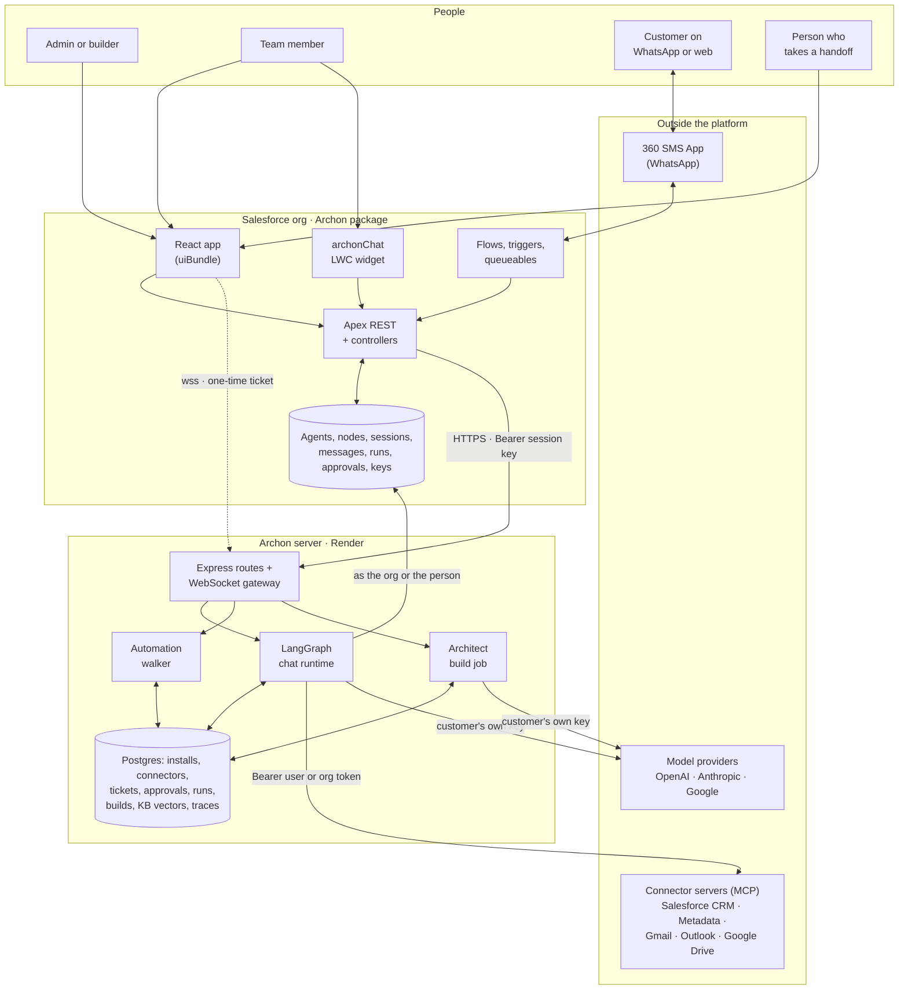

**Who talks to whom.** The browser never holds a server credential. Everything from the React app goes through Apex REST with the person's Salesforce session, and Apex calls the server with the org's session key. The one exception is the live chat socket: Apex mints a one-time ticket, and the browser opens the WebSocket with it. The server reaches back into the org as the Setup admin (for org-level work) or as the person (when a tool is configured to run as them). Connector servers are called by the server, never by the browser.

## 2. Principles the design follows

These are the rules you can see in the code. They are the architecture's promises to the customer.

1. **Salesforce is the system of record.** Agents, nodes, conversations, messages, run logs, approvals of automation runs and AI keys are Salesforce records. Postgres holds only what the server needs to run: installs, connector tokens, tickets, suspended tool calls, run checkpoints, build checkpoints, KB vectors and traces (section 8).
2. **The server never pays for a turn.** Every model call uses a key from the org's own `AiEngineConnection__c`, bound to the agent's AI node. There is no server-side fallback key for agents (chat/engine-resolver.ts:41-58; architect/specialists.ts:14-16).
3. **Tools run as a named principal.** Every tool call resolves to an org, group, user or pinned connection, by a per-node policy and an org-wide default, and the result is stamped on the call (identity/resolver.ts:107-201).
4. **Writes that need approval fail closed.** The approval gate never runs the tool inline; if the approval row cannot be written, the action still does not run (lc/approval-gate.ts:146-156).
5. **The browser gets no secrets.** No server URL, session key or API key reaches the React app. The WebSocket ticket is single-use and lives 45 seconds (db/ws-tickets.repo.ts:9,35-42).
6. **Every conversation is on record, including what the system did.** Approvals, handoffs, background outcomes and failures are written as System rows in the transcript (salesforce/approval-audit.ts; ChatSessionHandoffHandler.cls; lc/background-tools.ts:171-219).
7. **A person can always take over.** The handoff is a state on the conversation, so it works on every channel and survives a server restart (section 9.5).
8. **Degrade, do not 500.** A tool failure is a tool result the model sees; a missing connection becomes a card; a slow connector server is woken and waited for within a budget; a brake trips to a polite reply rather than a hang (lc/turn-budget.ts; lc/tool-failure.ts).

## 3. Containers

| Container | Runtime | Repository and branch flow | Deployed to | Owns |
|---|---|---|---|---|
| Salesforce package | Apex (API 67.0), custom objects, triggers, flows, one LWC, one React uiBundle | `SfdcAnnu/Archon-AI`; work on main, merged into Release, Dev, Pre-Release | Development org `AiAgentBuilderOrg` today; a 2GP managed package (namespace `archon`) is generated into `ArchonPackage/` | All business data, the admin UI, channel bridges, setup, wake, handoff state machine |
| Archon server | Node (tsx, no build step), Express 4, `ws`, LangChain + LangGraph, Prisma 5, pino | `SfdcAnnu/Aeventra-AI-Agent-Server`; main → Release, Dev, Pre-Release; **Render builds from Release** | `aeventra-ai-agent-server.onrender.com`, free tier, sleeps when idle | Chat turns, automation runs, Architect, system agents, connector identity, KB, schedulers, traces |
| Postgres | Render Postgres with pgvector | Prisma migrations in the server repo (`prisma migrate deploy` at start) | Render | 18 tables, section 8.2 |
| Salesforce CRM connector | Node, Express, MCP SDK 1.10, jsforce | `SfdcAnnu/Salesforce-MCP-Server`; Dev → main → Pre-Release and Release | `salesforce-mcp-server-02e7.onrender.com`, build marker v70 | 15 record tools plus dynamic Apex and Flow tools |
| Salesforce Metadata connector | Node 22, MCP server SDK 2.0, jsforce, pg | `SfdcAnnu/salesforce-metadata-mcp` | `salesforce-metadata-mcp.onrender.com`, starter plan, own Postgres | 29 metadata tools with a draft, validate, approve, deploy, rollback pipeline |
| Gmail and Outlook connectors | Node, Express, MCP SDK | `SfdcAnnu/Gmail-MCP-Server`, `SfdcAnnu/Outlook-MCP-Server` | `gmail-mcp-server-baqd` and `outlook-mcp-server-y4wg` on Render | 11 mail tools each |
| Google Drive | Google's hosted MCP endpoint | none | `drivemcp.googleapis.com/mcp/v1` | Drive read tools |
| Mobile demo | Capacitor 7 / Vite React | `SfdcAnnu/archon-mobile-demo` | Sideloaded APK and IPA from GitHub Actions | Demo client over `/api/mobile/*` |

Three more folders sit beside these: `SF-Assistant` (a local prototype, not a repository), `SMS MCP Server` (empty), and the root `src/` (the pre-LangChain server, ignored by git and no longer deployed).

## 4. The Salesforce package

### 4.1 Layers

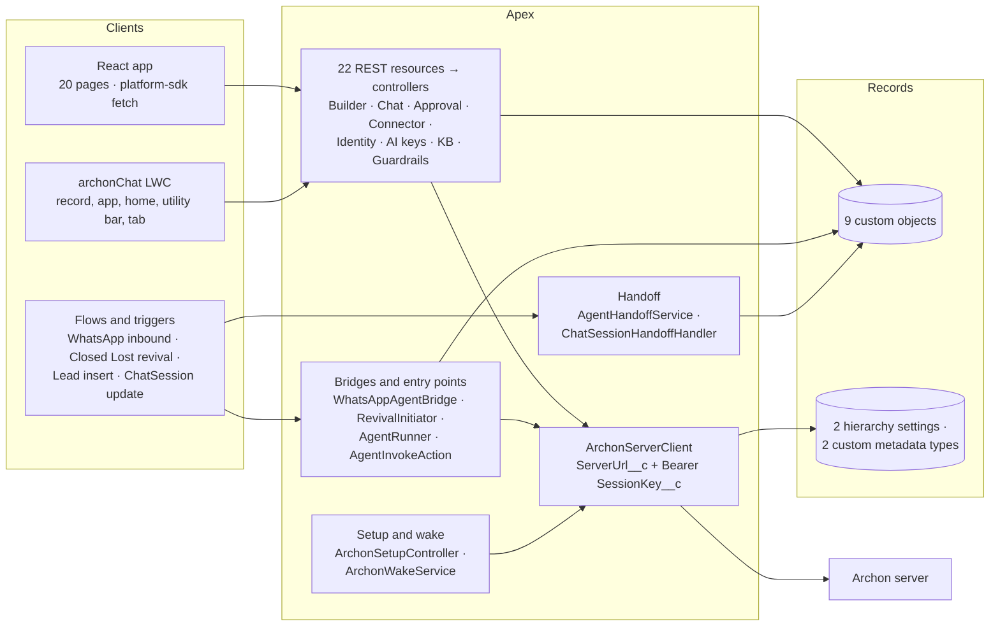

### 4.2 The REST surface

Every REST class is `global with sharing` and returns `{error}` with status 400 on failure. The React app calls these with the platform SDK's CSRF-aware fetch, trying the namespaced path `/services/apexrest/archon/...` first and falling back to the plain path, remembering the answer in `sessionStorage` (apex-client.ts:39-122).

| Resource under `/agent-builder/` | What it does | Server routes it proxies |
|---|---|---|
| `agent/*` | Load and save one agent with its nodes | none (Salesforce DML) |
| `agents` | List, delete, toggle status and streaming | none |
| `chat/*` | Start, send, end a session; upload a file; feedback; my connections; chat gate and requirements | `/api/chat/turn`, `/api/connectors/*` |
| `ws-ticket` | Mint a WebSocket ticket for the person | `/api/ws/ticket` |
| `conversations/*` | One session with messages, or my sessions | none |
| `approvals` | Automation approvals: list and decide | `/api/agent/runs/resume` |
| `chat-approvals` | Chat approvals: list and decide, adding the decider | `/api/chat/approvals`, `/decide` |
| `architect/*` | Build, resume, poll, detail, discard; rewrite; Ask Archon | `/api/architect/*` |
| `connectors`, `connectors-admin/*`, `mcp-tools/*`, `custom-actions/*` | Directory, OAuth start, custom MCP servers, tool schemas, Apex and Flow actions | `/api/connectors/*`, `/api/mcp-tool-schemas`, `/api/sf/custom-actions` |
| `identity/*` | Policy, roster, groups, users, server override, reminders | `/api/connectors/policy`, `/principals`, `/server`, `/reminders` |
| `engine-connections/*` | AI keys: save, delete, bind to a node, fetch models, test, set the embedding key | `/api/engine/test`, `/api/engine/models` |
| `executions/*` | Run logs and per-step traces | `/api/agent/runs/by-correlation/:id/steps` |
| `guardrails` | Org token cap | none |
| `handoff/*` | Queues, groups, status; return, reply, sweep | none |
| `home-stats` | Aggregates runs and turns, in user mode | none |
| `kb/*` | Storage config, documents, search, reindex | `/api/kb/*` |
| `salesforce-access` | Setup status and my Salesforce connections | `/api/setup/status`, `/api/connectors/mine` |
| `schema/*` | Objects and fields by describe | none |
| `setup` | Start, refresh, reset setup; wake the servers | `/api/setup/*`, `/health`, `/api/connectors/wake` |

The server's own HTTP surface is 76 routes (appendix A). The browser calls none of them directly.

### 4.3 Objects and settings

| Object | Kind and sharing | Purpose and the fields that matter |
|---|---|---|
| `AgentDefinition__c` | Custom object, Private, sharing reason `ArchonAccess__c` | The agent. `ApiName__c` (unique external id), `ExecuteType__c` (Chat = communication, Trigger = automation, Both), `Status__c`, `CanvasJson__c` (edges, spec, viewport), `SetupChecklistJson__c`, `IsSystem__c`, `StreamReplies__c`, `DebugMode__c`, `AccessMode__c`, `PostTurnAutomationAgent__c`, `Version__c` |
| `AgentNode__c` | Master-detail to the agent | One canvas node: `NodeType__c`, `NodeSubType__c`, `ConfigJson__c`, `PositionX__c`/`PositionY__c`, `SortOrder__c`, `IsEnabled__c`, `AiEngineConnection__c` (the bound key), `McpServer__c`, `McpTool__c` |
| `ChatSession__c` | Private | One conversation: agent, `User__c`, `Status__c` (Active, Handed off, Ended, Expired), `Channel__c`, `SenderPhone__c`, record context, memory summary and facts, token and latency totals, `PendingApprovalToken__c`, twelve `Handoff*` fields |
| `ChatMessage__c` | Master-detail to the session | One row per user, assistant, tool, system or human line: `Role__c`, `Content__c`, `ToolCallsJson__c`, `ToolResultsJson__c`, tokens, `LatencyMs__c`, `PhaseMsJson__c`, `TurnStatus__c`, approval fields, `AuthorUser__c`, `Feedback__c` |
| `AgentExecution__c` | ReadWrite | One automation run: `CorrelationId__c` (unique), `Status__c` (QUEUED … WAITING_APPROVAL), score, priority, reason, payloads, `ExecutionMs__c`, `RunMode__c` |
| `AgentApproval__c` | ReadWrite | One paused automation approval: `ApprovalToken__c` (unique join key), `ApproverId__c`, `Status__c`, `TimeoutAt__c` |
| `AiEngineConnection__c` | Private, history tracked | One AI provider key: `ApiKey__c` (EncryptedText), `EngineType__c`, `DefaultModel__c`, `Endpoint__c`, `OwnershipType__c`, `IsPreferred__c`, `UsedForEmbeddings__c`, `ValidationStatus__c` |
| `CustomMcpServer__c` | Read | An admin-added connector server: URL, `AuthStyle__c`, `PrincipalTypes__c`, `CatalogType__c` |
| `AgentKbChunk__c` | ReadWrite | Knowledge chunks for the Salesforce KB backend (keyword search, no vectors) |
| `ArchonInstall__c` | Hierarchy custom setting, Public | `SessionKey__c` (the org's server credential), `ConfiguredByEmail__c`, `ConfiguredAt__c` |
| `AgentGuardrails__c` | Hierarchy custom setting, Public | `IsEnabled__c`, `MaxTokensPerDay__c`, `MaxTokensPerMonth__c` |
| `ArchonConfig__mdt` | Custom metadata | `ServerUrl__c`; `JwtSecret__c` is unused by any code and stripped from the package |
| `ConnectorCatalog__mdt` | Custom metadata, 9 records | Display data, auth type, scopes and `McpServerUrl__c` per connector |

Fields added to standard objects serve the demo agents, not the platform, and the package build excludes them: `Lead.Project_Type__c`, `Project_Name__c`, `Budget__c`; `Opportunity.Loss_Reason__c`, `CompetitorIntel__c`; `Product2.MaxDiscountPercent__c`; `Account.Latest_closed_opp__c`.

### 4.4 The canvas model

An agent is a graph. Nodes are `AgentNode__c` rows; edges live in `AgentDefinition__c.CanvasJson__c` as `connections[{fromIndex, fromPort, toIndex, toPort}]`, keyed by node position in the sorted array (salesforce-data.ts:105-136; orchestrator/graph.ts:18-38).

| Node type | Sub-types | Configuration | Who reads it |
|---|---|---|---|
| `trigger` | record, schedule, webhook, platform_event | none beyond the kind | Automation walker |
| `ai` | claude, gpt4, gemini; `config.step = true` makes it an AI step | `systemPrompt`, `model`, `answerStyle`, `thinkingEffort`, `maxReplyTokens`, `fewShotExamples`, `budgets`, `customerFacing`, `bannedPhrases`; AI steps add typed `outputs` and `outputVariable` | Chat runtime; automation walker through the headless path |
| `subagent` | one per provider | `routingDescription`, `systemPrompt`, `model`, `mode` (transfer or call), `contextPolicy` | Chat runtime |
| `tool` | `actionType` MCP, Apex, Flow, Prebuilt, Handoff | `toolName`, `connectorId`, `requiresApproval`, `runInBackground`; Prebuilt adds `operation`, `object`, `selectedFields`, `boundFields`; Handoff adds who takes over, notifications, quiet hours, customer lines | Chat runtime |
| `catalog` | salesforce_crm_tools, storage_tools, email_tools, channel_tools | `provider`, `allowedTools`, `runAs`, `fallback`, `required`, `automationRunAs`, `allowedDomain`, `backgroundTools` | Chat runtime; identity resolver |
| `logic` | if_else, loop, wait, approval, set_variable | condition, collection, wait length, timeout hours | Automation walker |
| `action` | query_records, get_record, create_record, update_record, create_task, post_chatter, call_tool | object, field mappings, record id tokens | Automation walker |
| `end` | | | Automation walker |

Ports: `in`, `out`, `tool`, `yes`, `no`, `each`, `done`, `approved`, `rejected`. The `tool` port is the one the chat runtime reads: anything wired from an AI node's `tool` port becomes that node's tool, catalog or subagent. Every other port is flow for the automation walker.

The agent kind comes from `ExecuteType__c`: communication agents stop at every reply and are driven by a person or a channel; automation agents run in one go from a Flow, Apex or a schedule and return a result. Voice is a way of talking to a communication agent in the browser (speech in, speech out, mic level on the orb), not a separate kind.

### 4.5 The React app

The app is a Salesforce UI Bundle: Vite builds `dist/`, which is committed and deployed with the rest of the package, and the custom application `Agent_Builder` points at it. It runs React 19 with react-router 7 (browser history under the bundle's base path) and `@xyflow/react` for the canvas. It knows nothing about the user except what Apex tells it: the platform SDK's fetch carries the Salesforce session, and every Apex method works out "me" on the server side.

Twenty routes: Home, the command-centre Home with the Archon bar, Environments, the Agent Builder canvas, Settings, Templates, Conversations, New Agent (the Architect entry), Knowledge, Cost, Executions, Approvals, AI Connections, Connectors, My Connections, Setup, Chat, the full-screen Archon copilot, Trace, and Not Found (routes.tsx).

The chat client (`ChatPanel.tsx`) starts a session through Apex, mints a ticket, opens the socket, sends `{newUserMessage, history, attachments, stream}`, renders `text.delta` frames into a streaming row and replaces it with the final `ChatTurnResult`. It polls chat approvals, decides them through Apex and sends a `continuation` turn when one is executed. Speech recognition and synthesis are the browser's own; the Architect runs as copilot tool calls whose `jobId` the panel polls every 2.5 seconds.

The `archonChat` LWC is the second client: a widget for record pages, app pages, the utility bar and a tab. It calls `AgentChatController` directly over HTTP turns, without streaming.

## 5. The Archon server

### 5.1 Components

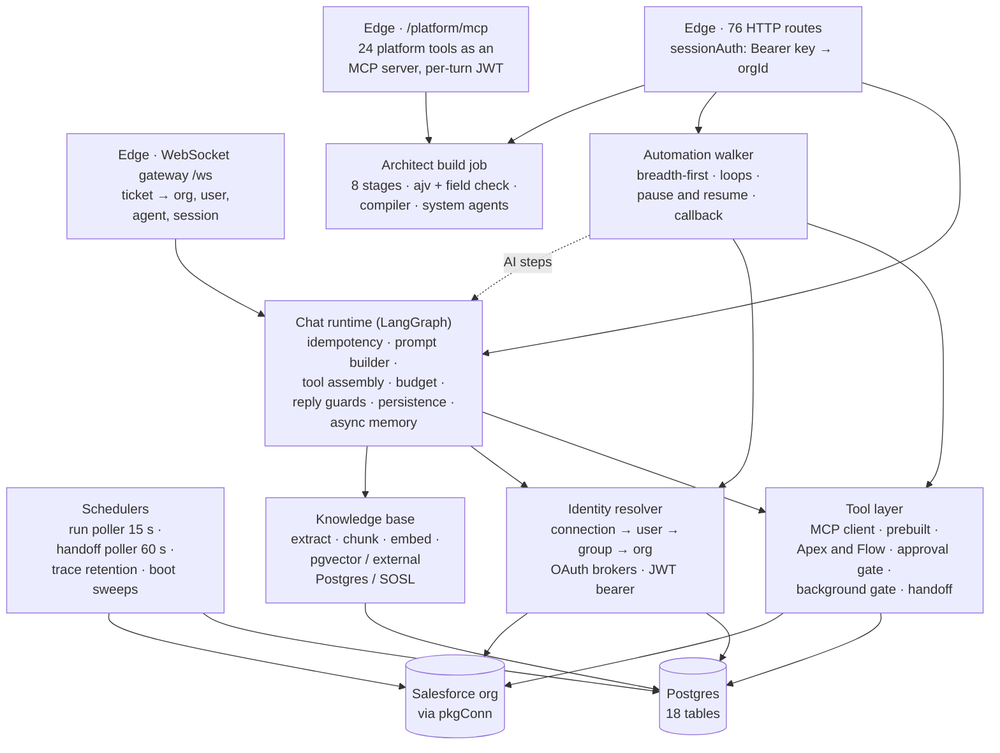

System agents reach the platform tools through the tool layer like any other MCP server, over loopback.

### 5.2 The chat runtime

One turn is one pass through `runLangGraphTurn` (lc/graph-runtime.ts), wrapped by `withTurnIdempotency` so a duplicate request joins the in-flight promise or replays a result for two minutes (chat/turn-idempotency.ts:23-83). The runtime:

- loads the agent from Salesforce through a cache that is fresh for 60 seconds and served stale for up to 30 minutes while it reloads (chat/agent-cache.ts:52-93);
- waits for young background writes (section 9.6), starts the KB and record-context fetches early, and loads the install, the org connection and the session memory in parallel;
- builds the system prompt in a stable part (instructions, examples, business rules, fixed runtime rules) and a volatile part (time, KB passages, record block, memory, channel and language lines, background results); on Claude the stable part is marked for prompt caching (graph-runtime.ts:119-130);
- picks the model from the AI node's sub-type and the key bound to it, through `ChatOpenAI`, `ChatAnthropic` or `ChatGoogleGenerativeAI` (lc/models.ts:148-245);
- assembles tools: MCP tools through one `MultiServerMCPClient` per server with the resolved token and `X-Archon-Approval: granted`, prebuilt `do_*` and `find_*` tools with bound fields, Apex and Flow tools through the CRM connector's `?custom=` list, `ask_*` and `handoff_to_*` tools for subagents, `hand_off_to_human`, `read_artifact`, and the platform tools for system agents; then wraps approval-gated and background tools and sorts the list for cache stability;
- runs a two-node LangGraph (`router` and `tools`) until the model answers with text and no tool calls, a subagent takes over, a brake trips, or all remaining calls are background writes and the message already has text (speak then act);
- guards the reply: a narration-only or deferral ending gets one more call; a customer-facing agent gets up to two corrective passes against unbacked action claims; banned phrases are regenerated then scrubbed (graph-runtime.ts:653-743; chat/output-guardrails.ts);
- sends the result, then persists the turn to Salesforce fire-and-forget, updates memory when the unsummarised tail passes 30 messages, and generates a title on turn 3.

Budgets: 80k tokens, 90 seconds and 24 steps by default, with ceilings of 200k, 110 seconds on HTTP or 540 on the socket, and 40 steps; the third identical tool call is blocked and the fifth trips the loop brake (lc/turn-budget.ts:67-106). Phase timings (`setup`, `resolveServers`, `loadTools`, `background.await`, `buildPrompt`, `modelLoop`) travel in the result and land in `PhaseMsJson__c` on the assistant row, written by the server on socket turns and by Apex on HTTP turns (ws-chat-persistence.ts:248-254; AgentChatController.cls:1105).

Subagents come in two modes. **Transfer** (`handoff_to_<slug>`) ends the root turn and runs the subagent's own graph; its reply is the turn's reply. **Call** (`ask_<slug>`) runs the specialist as a tool and returns its last text to the root. Subagents never get subagent tools, so the depth is two (chat/subagent-router.ts:18-21).

### 5.3 The automation walker

`POST /api/agent/execute` runs an automation agent against one record. The walker is deterministic: a breadth-first queue over the graph, each node at most once, disabled nodes skipped, at most 100 nodes per burst, loops of at most 100 iterations with no nesting (orchestrator/engine.ts:22-23,163-262). Node executors cover triggers, logic (`if_else`, `set_variable`, `wait`, `approval`), record actions through the per-org connection, `call_tool` for MCP and custom actions with policy-resolved identity, and AI steps that reuse the chat runtime headlessly with typed outputs and one repair call (nodes/ai-step.ts:30-60). Expressions are `{! path | FUNC() }` tokens with nine functions and AND/OR conditions (orchestrator/expressions.ts).

A `wait` over 60 seconds or an `approval` node pauses the run: the engine checkpoints context, aliases, frontier and visited set to `AgentRun`, and marks it WAITING or WAITING_APPROVAL. Resumption comes from `POST /api/agent/runs/resume` (Apex calls it when an `AgentApproval__c` is decided) or from the run poller every 15 seconds, which resumes due waits and auto-rejects overdue approvals (scheduler/run-poller.ts:21-86). Results go back by upserting `AgentExecution__c` on `CorrelationId__c` through the org connection; Platform Events were dropped because Professional Edition lacks them (salesforce/callback.ts:122-169; PACKAGING.md §2).

### 5.4 The Architect

A build is a job with eight stages and a cost ceiling, resumable from a checkpoint in `ArchitectBuild`. The org is surveyed first (objects, invocable Apex and Flows, live MCP tool lists, knowledge bases). Specialists with set tiers and knowledge files analyse the requirement, match capabilities, design the flow (up to three attempts with free deterministic repairs and an ajv schema plus field check against describes), write prompts, review the design against the requirement with one repair round, report gaps as prerequisites, and compile to `AgentDefinition__c` and `AgentNode__c` rows (architect/build-job.ts:915-1777; architect/compiler.ts). The default ceiling is $4 a build; a resume adds $2 (build-job.ts:467,537). Measured in September 2026: about five minutes and under $0.50 with a review and repair round.

The copilot drives it: `build_agent` returns a job id after about four seconds and the UI polls. Stage tools (`analyze_requirement`, `inspect_org`, `design_agent`, …) run the same job with a stop-after flag, so Archon can narrate a build step by step.

### 5.5 System agents and platform tools

Two agents ship with the platform as JSON specs and are written into the org's ordinary records: `archon_copilot` (version 17, managed, its nodes rewritten on every sync) and `metadata_expert` (version 2, created once and left alone). They use the org's preferred AI key. Their tools are the server's own 24 platform tools, served to the runtime as an MCP server at `/platform/mcp` over loopback with a 15-minute HS256 token minted per turn (platform/mcp-endpoint.ts; platform/token.ts). The set covers lookups, a read-only inspector, the Architect, agent edits behind approval, `show_on_screen` for the Archon surfaces, `transfer_to_agent`, `open_page`, `wake_servers` and `activate_agent`.

### 5.6 Knowledge base

Documents are uploaded through Apex, extracted (PDF or text), chunked at about 800 tokens with 150 overlap, embedded with OpenAI `text-embedding-3-small` on the org's embedding key, and stored in one of three backends chosen per org: Archon's Postgres with pgvector (default), the customer's own Postgres, or `AgentKbChunk__c` with SOSL keyword search and no vectors (kb/backends). Retrieval takes the top six passages into a KNOWLEDGE BASE block in the prompt, cached 60 seconds per query.

## 6. Identity and connectors

Who a tool runs as is decided per call, from the node's policy and the org's defaults.

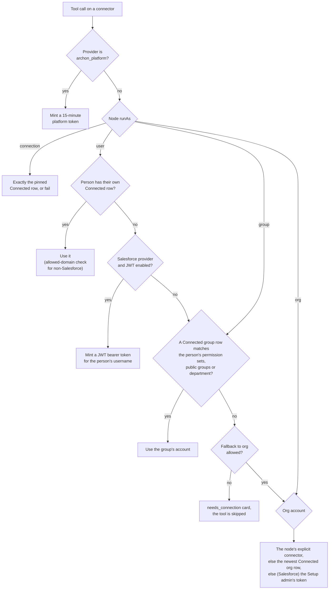

Defaults per org (`OrgIdentityPolicy`): run as user, no fallback, block org fallback in chat, groups keyed by permission set, JWT off, reminders every 3 days up to 3 (identity/policy.ts:54-63). Connected accounts are Postgres `Connector` rows per org × provider × principal; tokens are sealed at rest. Google and Microsoft accounts come from a server-brokered OAuth popup; a Salesforce per-user account from the same External Client App with PKCE, or from the JWT bearer flow with no click when the admin turns it on and the server holds `SF_JWT_CLIENT_ID` and `SF_JWT_PRIVATE_KEY`. Every tool call carries `ranAs` (principal and how the token came: connection, jwt, setup or platform) into the transcript.

The connector servers themselves are stateless towards Archon: the CRM server runs every tool under the bearer of the live request, so Salesforce sharing and field security are the boundary (Salesforce MCP Server src/lib/sf.ts:12-30); the Metadata server accepts a raw Salesforce token or its own OAuth tokens, encrypts stored credentials with AES-256-GCM, and gates every write behind a human approval page unless the caller sends `X-Archon-Approval: granted`, which Archon does only after its own gate has passed.

## 7. Channels

| Channel | Inbound path | Outbound path | Notes |
|---|---|---|---|
| Web chat (React) | `ws-ticket` → WebSocket → turn | streamed frames and the final result | Attachments uploaded as ContentVersions first |
| Record widget (LWC) | `AgentChatController.sendTurn` → `/api/chat/turn` | HTTP response | No streaming, no handoff banner yet |
| WhatsApp | 360 SMS App `tdc_tsw__Message__c` → Flow `WhatsApp_Incoming_Message_Handler` → `WhatsAppAgentBridge` → queueable → `/api/chat/turn` | `tdc_tsw.GlobalSMSSender` from a chained queueable | Handed-off sessions store the message and skip the turn; failure falls back to a canned reply or a Task |
| Revival (outbound first) | Flow `Opportunity_Closed_Lost_Revival` → `WhatsAppRevivalInitiator` | a 360 SMS template, logged as the first message of a new session | Skips when there is no contact or an active session |
| Flow and Apex | `AgentInvokeAction` ("Call AI Agent") or `AgentRunner` ("Run AI Agent") | invocable outputs; `AgentExecution__c` | Record-triggered flows must use the asynchronous path |
| Mobile demo | `/api/mobile/chat` with a 30-day session or the demo token | HTTP | Demo only |

Automation channel nodes (`outlook`, `gmail`, `sendgrid`, `twilio`, `whatsapp`, `slack`, `teams`) exist in the walker as stubs that send nothing (nodes/channel.ts:9-34). Sending from an automation today means a Flow action or an MCP tool.

## 8. Data architecture

### 8.1 What lives where

| Concern | Salesforce | Postgres | In process only |
|---|---|---|---|
| Agent design | `AgentDefinition__c`, `AgentNode__c` | build checkpoints (`ArchitectBuild`) | agent cache |
| Conversations | `ChatSession__c`, `ChatMessage__c` | suspended tool calls (`ChatApproval`), queued writes (`BackgroundToolRun`), tickets (`WsTicket`) | tool results, artifacts (30 min), record blocks |
| Automation | `AgentExecution__c`, `AgentApproval__c` | run checkpoints (`AgentRun`, `RunStep`) | |
| Credentials | `AiEngineConnection__c.ApiKey__c` (EncryptedText), `ArchonInstall__c.SessionKey__c` | `OrgInstall` tokens, `Connector` tokens, server override keys (all sealed with `ENCRYPTION_KEY`) | platform token secret if not configured |
| Identity | permission sets, public groups, departments (read live) | `OrgIdentityPolicy`, `ConnectorServerOverride`, `ConnectionReminder`, `PendingOAuth` | membership cache (5 min) |
| Knowledge | `AgentKbChunk__c` (one backend) | `KbStorageConfig`, `KbDocument`, `KbChunk` with `vector(1536)` | |
| Observability | `PhaseMsJson__c`, `LatencyMs__c`, token fields | `AgentTrace`, `AgentTraceStep` (redacted, 90 and 14 days) | pino logs |
| Configuration | `ArchonConfig__mdt`, `ConnectorCatalog__mdt`, `CustomMcpServer__c`, `AgentGuardrails__c` | | environment variables |

### 8.2 Postgres models

| Model | Keyed by | Holds | Retention |
|---|---|---|---|
| `OrgInstall` | orgId | session key, Setup admin's Salesforce tokens, instance URL | until reset |
| `PendingSetup` | state | PKCE and pre-minted key for one Setup attempt | swept after 10 min |
| `Connector` | uuid; indexed by org, provider, principal | connected account tokens and metadata | until disconnect (tokens nulled) |
| `OrgIdentityPolicy` | orgId | defaults for runAs, fallback, JWT, reminders | indefinite |
| `ConnectorServerOverride` | orgId + providerKey | admin URL and key override | until deleted |
| `ConnectionReminder` | org + provider + user | count of reminders sent | no sweep |
| `PendingOAuth` | state | connector OAuth round trip | deleted on callback; no sweep |
| `WsTicket` | id | one WebSocket ticket | 45 s; expired rows deleted on each mint |
| `AgentRun`, `RunStep` | uuid, correlationId | durable automation state and per-node trace | no retention |
| `ChatApproval` | uuid | a suspended chat tool call and its outcome | lazily expired after 24 h |
| `BackgroundToolRun` | uuid | a queued write and its outcome | orphans failed at boot; no sweep |
| `ArchitectBuild` | jobId | checkpoint, steps, costs, result | until discarded |
| `KbStorageConfig`, `KbDocument`, `KbChunk` | orgId, uuid | backend choice, documents, vectors | until deleted |
| `AgentTrace`, `AgentTraceStep` | uuid | redacted turn traces | 90 days; payloads 14 days |
| `MobileSession`, `MobileAuthPending` | sha256(token), state | demo sessions | 30 days; 10 min |

The namespace is detected per org and applied only through `pkgConn`, so the same server serves a namespaced package org and the un-namespaced development org (salesforce/namespace.ts:12-30,249).

## 9. Key flows

### 9.1 Org setup

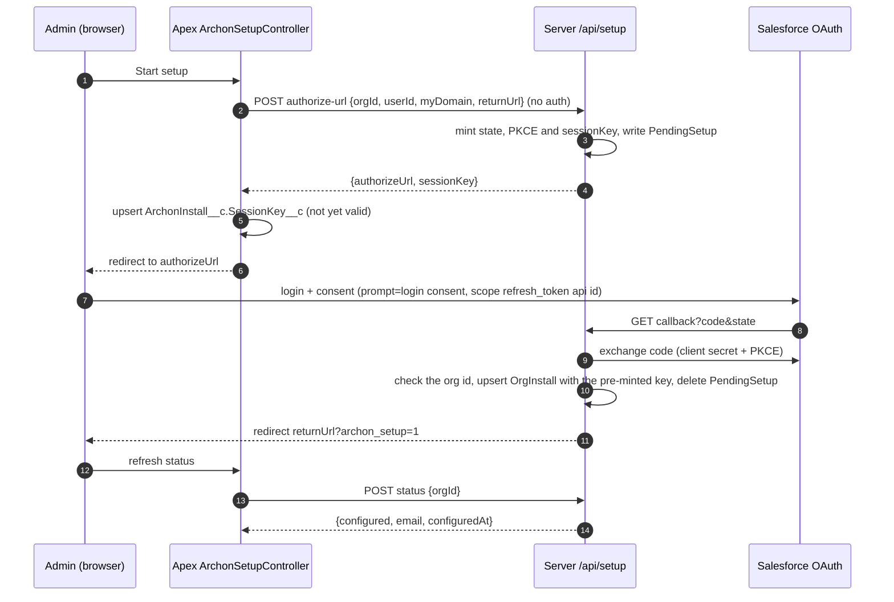

From here every Apex call carries `Authorization: Bearer <SessionKey__c>`, and the server resolves it to the org (auth/session.ts:24-50). The server's connection into the org is the admin's refresh token, refreshed proactively and on 401 (salesforce/per-org-connection.ts).

### 9.2 A chat turn over the WebSocket

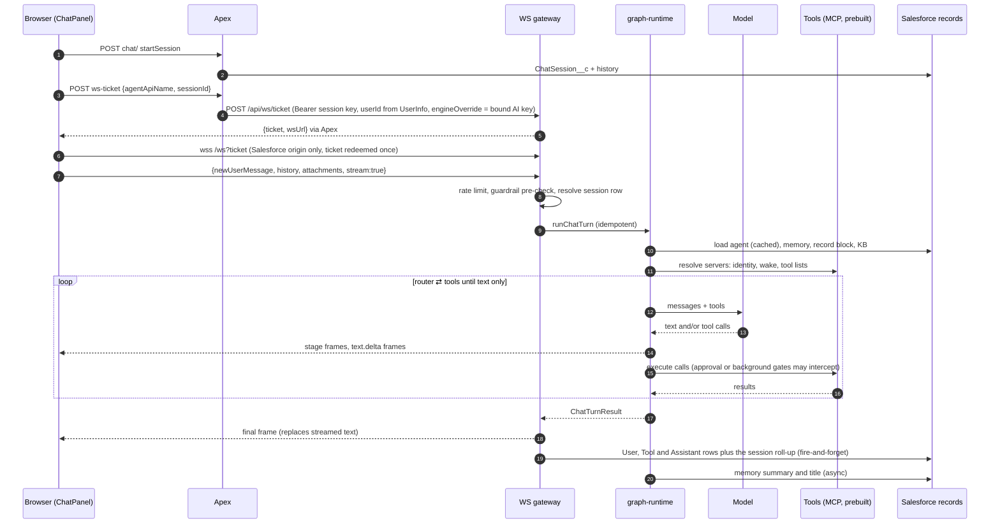

What ends a turn: text with no tool calls, a subagent transfer, a tripped brake, or text plus only background tool calls. Errors arrive as `{status:'error', error}` frames with codes such as `guardrail_exceeded` or `chat_turn_failed`, and a failed turn is still written to the transcript with `TurnStatus__c = Failed` (ws/gateway.ts:235-271,323-343).

### 9.3 A WhatsApp message

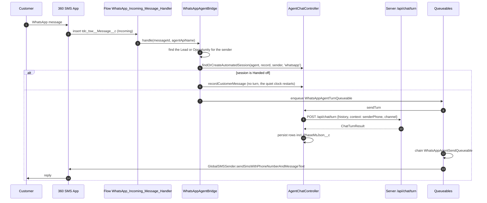

If the send fails, the queueable falls back to a canned reply or a follow-up Task (WhatsAppAgentBridge.cls:285-288). The flow's entry filter is pinned to one business number; the package build excludes the flow and the bridge classes, because they depend on the 360 SMS App namespace `tdc_tsw`.

### 9.4 An approval in chat

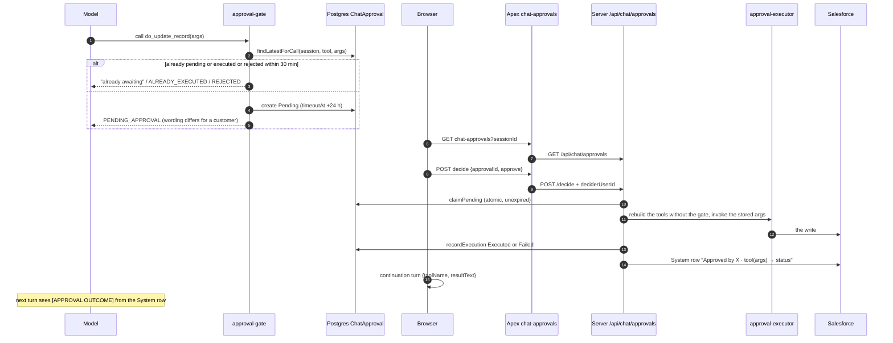

Automation approvals are a different path: an `approval` node submits a Salesforce approval process on the record and pauses the run; `AgentApproval__c` is decided in the app and Apex calls `/api/agent/runs/resume`; the poller auto-rejects overdue ones (nodes/logic.ts:154-193; AgentApprovalController.cls:49).

### 9.5 Handoff to a person, and back

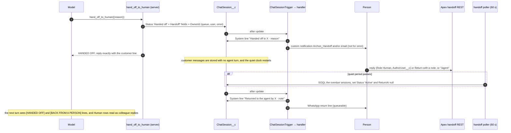

The state lives on the session, so a handoff survives a server restart and a cold start; the only thing that moves to the server is the quiet-period sweep (scheduler/handoff-poller.ts:34-61). Omni-Channel routing works by setting the owner to a queue with a routing configuration; the packaged `Archon_Conversation` service channel exists, but closing the Omni work item does not yet return the conversation (section 13).

### 9.6 A background write

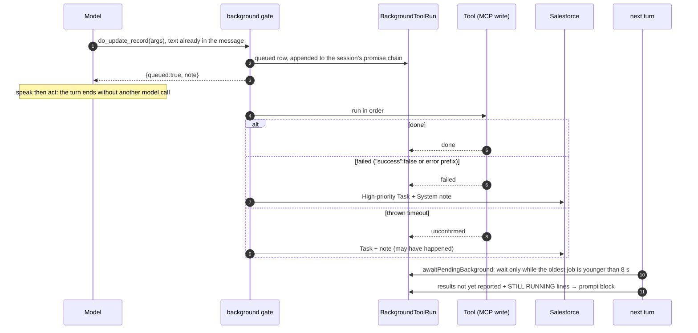

The rules were agreed for slow enterprise orgs: a young write is given up to eight seconds before the next reply; an older one is reported as still running; a timeout is never called a failure; a restart leaves a Task for every orphaned row (lc/background-tools.ts:77,127-164,273-327,370-392). Speak then act needs a model that emits text together with tool calls; gpt-4.1 does not, the gpt-5 family does.

### 9.7 An automation run

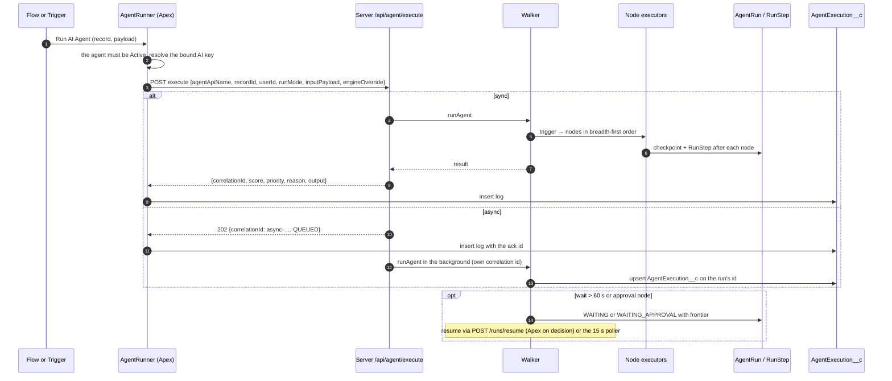

The async acknowledgement id and the run's own id differ, so an asynchronous run produces two `AgentExecution__c` rows, one of which stays QUEUED (routes/agent.routes.ts:70; orchestrator/engine.ts:31; AgentRunner.cls:136-138). This is listed in section 13.

### 9.8 An Architect build

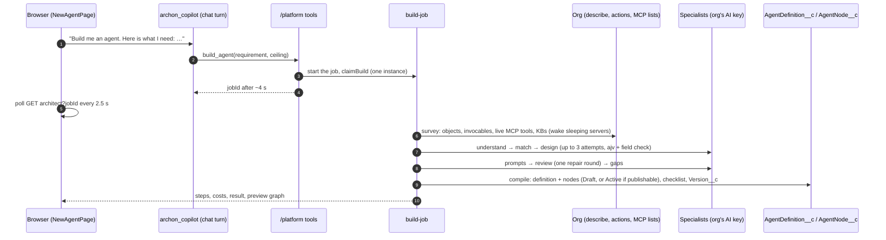

Every stage is checkpointed to `ArchitectBuild`, so a build that hits its ceiling pauses and can be resumed with more budget; orphaned builds are failed at boot (architect/build-job.ts:301-317,433-442).

### 9.9 Waking the servers

Render's free tier sleeps. `ArchonWakeService` probes `/health` and treats a 502, 503, HTML page or timeout as "waking"; once the server answers, it posts every connector URL to `/api/connectors/wake`, which pings each origin with a 12-second cap and classifies it online, waking or unreachable (ArchonWakeService.cls:1-74; routes/wake.routes.ts:33-143). The chat runtime also wakes a sleeping connector before a turn, up to five tries within 45 seconds, leaving 20 seconds for the model (lc/mcp-tools.ts:332-372). By the sponsor's decision there is no automatic retry in the Home UI; the Setup button wakes, and the AWS move removes the problem.

## 10. Security architecture

### 10.1 Trust boundaries and authentication per hop

| Hop | Credential | Where it is checked |
|---|---|---|
| Browser → Apex REST | The person's Salesforce session, CSRF-aware fetch | Salesforce; `with sharing`, `WITH USER_MODE` in most queries |
| Browser → WebSocket | One-time ticket (45 s) minted by Apex; origin must be a Salesforce domain; https required in production | ws/gateway.ts:388-447 |
| Apex → server | `Bearer ArchonInstall__c.SessionKey__c` (unique per org) | auth/session.ts:24-50 |
| Server → Salesforce (org work) | Setup admin's access token, refreshed from the refresh token | salesforce/per-org-connection.ts |
| Server → Salesforce (as a person) | The person's Connector token, or a JWT bearer token minted for their username | identity/resolver.ts |
| Server → connector servers | `Bearer <resolved token>` + `X-Archon-Approval: granted` | lc/mcp-tools.ts:376-405 |
| Runtime → platform tools | HS256 JWT, 15 min, issuer `archon-platform` | platform/token.ts |
| Server → model providers | The agent's bound `AiEngineConnection__c` key, passed by Apex in `engineOverride` | chat/engine-resolver.ts |
| 360 SMS App → Apex | Flow in the org; no external call | |
| Admin → trace console | `ADMIN_API_KEY` ≥ 16 chars, constant-time compare, 404 on failure | routes/admin-traces.routes.ts |

### 10.2 Secrets

| Secret | Where it rests | Protection |
|---|---|---|
| Org session key | `ArchonInstall__c.SessionKey__c` (Salesforce) and `OrgInstall.sessionKey` (Postgres) | Plain text in both: a lookup column on the server, a Public hierarchy setting in the org (not Protected) |
| Setup admin's Salesforce tokens | `OrgInstall` | AES-256-GCM via `ENCRYPTION_KEY` |
| Connector tokens and API keys | `Connector`, `ConnectorServerOverride` | AES-256-GCM |
| AI provider keys | `AiEngineConnection__c.ApiKey__c` | Salesforce EncryptedText; in transit to the server inside `engineOverride`; copied unsealed into `WsTicket.engineOverride` (45 s) and `AgentRun.engineOverrideJson` (no retention) |
| Salesforce JWT private key | `SF_JWT_PRIVATE_KEY` env var (PEM) | Render environment; moves to a secret store on AWS |
| OAuth client secrets | env vars `SF_MCP_CLIENT_SECRET`, `GOOGLE_CLIENT_SECRET`, `MS_CLIENT_SECRET` | Render environment |
| Platform token secret | `PLATFORM_TOKEN_SECRET` or random at boot | Random works on one instance only |
| `JwtSecret__c` | `ArchonConfig__mdt` record in git | Unused by any code; stripped from the package; the committed value should be removed |

With no `ENCRYPTION_KEY` the server logs one warning and stores secrets in clear text (lib/secret-box.ts:120-126). Traces redact keys, tokens, bearer strings, session ids and JWTs by key name and value pattern (trace/redact.ts).

### 10.3 Permissions in the org

Two permission sets: **Archon Admin** (`AgentBuilderUser`) grants 44 classes, full access to agents and nodes, Modify All on approvals, AI keys and custom servers, create/read/edit on sessions and messages, the app and tabs, `ApiEnabled` and `ViewEncryptedData`. **Archon Agent Invoker** (`AgentChatUser`) grants eight classes centred on `AgentChatController`, read on agents and nodes, create/read/edit on sessions and messages, and the chat tab. The invoker set does not include the REST classes the React chat page uses (`AgentChatRestService`, `AgentConversationsRestService`, `AgentWebSocketController`, `AgentListRestService`), so a chat-only user is served by the LWC widget, not the React chat (section 13). Two classes run `without sharing` on purpose: the guardrail total (org-wide sum) and the key reader that fetches an agent's bound key regardless of the chatting user's access. There is no `stripInaccessible` yet.

### 10.4 Browser policy

The org declares one CSP trusted site (`wss://aeventra-ai-agent-server.onrender.com`, connect-src) and one Remote Site Setting for the same host over https. Connector hosts need neither, because only the server calls them.

## 11. Deployment and environments

| Environment | What | Notes |
|---|---|---|
| Development org `AiAgentBuilderOrg` | The un-namespaced project, six agents, the 360 SMS App installed | API 68.0; `orgfarm-ac9142a7a9-dev-ed.develop.my.salesforce.com` |
| Archon server | Render web service from the server repo's Release branch; `/health` reports commit and branch; verified today: commit cf86f662, branch Release | Free tier: sleeps, cold start up to ~90 s; `prisma migrate deploy` runs at start |
| Postgres | Render Postgres with pgvector | `DATABASE_URL` |
| Connector servers | Four Render services (CRM, Metadata, Gmail, Outlook) plus Google's hosted Drive endpoint | URLs in `ConnectorCatalog__mdt`; the Metadata service has `render.yaml` with a starter plan and its own Postgres; the others are configured by hand |
| Managed package | `ArchonPackage/` generated by `scripts/build-package-source.py` from git-tracked `force-app`, namespace `archon`, version 0.1.0 Beta 1 | Excludes the WhatsApp bridge, demo fields, flows and triggers; the copy is from 27 September and predates the handoff and identity work (section 13) |

**Release steps today.** Salesforce: build the React app (`npm run build` fails on any hard-coded colour), deploy with `sf project deploy start`, commit on main, merge into Release, Dev and Pre-Release, push. Server: commit on main, merge, push; Render builds Release in about two minutes; poll `/health` for the new commit. Connector servers: the CRM server bumps a build marker in `src/server.ts` so the deploy is visible at `/`. The runbook (document 05) will carry the exact commands and the environment variables, of which the server reads about 90 (appendix C).

**Planned.** An always-on AWS footprint (container, managed Postgres, secret store) replaces Render's free tier. The single-instance assumptions in section 12.4 must be resolved before running more than one container.

## 12. Cross-cutting concerns

### 12.1 Latency

A warm chat turn is about two to four seconds; the model loop dominates. Measured phases live in `PhaseMsJson__c` per assistant row, so a slow turn can be read before it is theorised. Each Render-to-Postgres round trip costs about 465 ms, which is why installs, agents, tool lists, memberships, record blocks and KB answers are all cached in process with stale-while-revalidate windows. A write turn drops from about 3.7 to about 1.8 seconds with Background tools on a model that speaks and acts in one message.

### 12.2 Cost

Tokens in, out and cached are recorded per message and rolled up per session and per model (`UsageByModelJson__c`); the Cost page shows tokens and latency, not dollars. Architect builds price every specialist call against a per-model table and stop at the ceiling. The platform spends nothing on a customer's turns; the server's own `OPENAI_API_KEY` and `ANTHROPIC_API_KEY` are used only by the in-process model helpers, not by agents.

### 12.3 Observability

pino logs on every request and on `lc_turn_complete`, `lc_billing` and `mcp_tool_call`; `/health` with commit and branch; per-turn phase timings in Salesforce; optional full traces (`TRACE_CAPTURE=full`) in Postgres with redaction, 90-day retention and an admin console behind `ADMIN_API_KEY`; run steps per node for automations; the Trace page in the app for a session's raw request and response.

### 12.4 Resilience and scale

What protects a turn: idempotent turn keys, fail-closed approvals, stale-while-revalidate caches, one retry on transient tool errors (never for a create that was sent), wake budgets for sleeping servers, turn brakes, and boot sweeps that fail orphaned builds and background rows and leave Tasks. What limits scale today: the platform token secret, tool-list cache, membership cache, artifacts, rate limits and the handoff and run pollers are all in process; the run poller takes no lock before resuming; a second instance would duplicate pollers and reject tokens minted by the first. Multi-tenancy itself is sound: every Postgres query is scoped by `orgId`, every Salesforce call uses the org's own connection, and the namespace is detected per org.

## 13. Known gaps and technical debt

Each item names the place in the code. The product requirements (document 02) will decide which ship in the next release.

**Correctness**
1. An asynchronous automation run writes two `AgentExecution__c` rows: Apex logs the acknowledgement id, the server upserts the run's own id (routes/agent.routes.ts:70; orchestrator/engine.ts:31; AgentRunner.cls:136-138). Fix: have the route pass its correlation id into `runAgent`.
2. `GET /api/agent/status/:correlationId` is a stub (routes/agent.routes.ts:120-127).
3. Automation channel nodes send nothing; `apex_action`, `einstein`, `sentiment` and `embed` steps fail as stubs; the in-process `storage`, `email` and `channels` helpers return `stub: true` (nodes/channel.ts; nodes/action.ts:226-231; nodes/ai.ts:182-201; mcp/servers). Either build them or remove them from the palette.
4. Closing an Omni-Channel work item does not return the conversation; the `Archon_Conversation` service channel is shipped but nothing in Apex references it.

**Security**
5. `ArchonConfig__mdt.JwtSecret__c` has a committed value in `customMetadata/ArchonConfig.Default.md-meta.xml`, is read by nothing, and should be removed from the repo and the object.
6. `ArchonInstall__c` is a Public hierarchy custom setting holding the org's server credential in plain text; make it Protected.
7. The AI key is sent to the server on every ticket and run inside `engineOverride` and stored unsealed in `WsTicket.engineOverride` and `AgentRun.engineOverrideJson` (db/ws-tickets.repo.ts:17; db/runs.repo.ts:34). Seal both or replace with a key reference the server resolves.
8. `GET /api/artifacts/:id` does not check that the artifact belongs to the caller's org (routes/artifacts.routes.ts:14-25).
9. No `stripInaccessible` anywhere; several controllers suppress the CRUD lint; some DML runs without user mode (ArchonSetupController, AgentApprovalController.decide, AgentRunner). AppExchange review will ask.
10. Trace retention runs only when the admin console is enabled; `TRACE_CAPTURE=full` without `ADMIN_API_KEY` writes traces that are never swept (index.ts:65-69).
11. The Gmail and Outlook connector servers register tools against the session opener's bearer rather than the live request's, and log a bearer prefix (Gmail server.ts:19,108-115). The CRM server fixed the first point with `AsyncLocalStorage`.

**Access**
12. The Archon Agent Invoker permission set omits the REST classes the React chat uses, so a chat-only user cannot use the React chat page; the LWC widget works.

**Operations and scale**
13. Single-instance assumptions listed in 12.4; the random platform token secret when `PLATFORM_TOKEN_SECRET` is unset.
14. No sweeps for `PendingOAuth`, `ConnectionReminder`, `AgentRun`, `BackgroundToolRun` or expired `MobileSession` rows.
15. The run poller resumes without a claim; two instances would double-run.

**Packaging and documentation**
16. `ArchonPackage/` is from 27 September and lacks the handoff, identity and reminder classes, the twelve `Handoff*` fields, `AuthorUser__c`, the notification types and the service channel; `AgentHandoffService` now calls `tdc_tsw.GlobalSMSSender`, which the package build's check will reject. The WhatsApp send must move behind an interface the package can ship without the 360 SMS App.
17. `PACKAGING.md` still says Synapse AI, namespace `synpsai` and a Named Credential; the docs from June and July 2026 (`CHAT_AGENT_ARCHITECTURE.md`, `CONFIGURATION_GUIDE.md`, `USER_GUIDE.md`, `TEST_PLAN.md`, the project brief) describe the pre-LangChain product. This document set supersedes them; they should be moved to an archive folder.
18. `ConnectorCatalog__mdt` promises more than the servers do: the CRM record's description mentions reports and Chatter (the server has neither), the Gmail record's scopes (`gmail.send gmail.readonly`) differ from the server's (`gmail.modify`); the Metadata server's README says Archon is "not wired yet", which is stale.
19. Minor: `GraphQL` client unused; an unused Architect fallback path in `ChatPanel`; `architect/flow.ts:52` says 50 nodes where the engine allows 100; `add_agent_tool` says it waits for approval but its node has no `requiresApproval`; the `salesforce-einstein` registry entry has no file; the `SMS MCP Server` folder is empty.

**Product claims**
20. The website promises voice on telephone calls and same-day go-live; the code has browser voice only. Charter decision 8.

## 14. Architecture decisions

| Decision | Why | Consequence |
|---|---|---|
| Salesforce is the system of record; Postgres holds runtime state only | Customers already trust and govern Salesforce; AppExchange expects it | Two stores to keep consistent; the server must survive with Postgres lost except for installs and connectors |
| The server is the MCP client (LangGraph's ToolNode executes calls), not the model provider | One code path for OpenAI, Anthropic and Google; full visibility of every call; approvals and identity enforced in one place | 100–300 ms extra per call for session set-up; the server needs connector tokens |
| No server-side model key for agents | The platform never pays for a customer's turn; keys stay the customer's | Every agent needs a bound key before it runs; keys travel in `engineOverride` |
| Browser talks to Apex only, except the live socket with a one-time ticket | Keeps all secrets out of the browser; works inside Salesforce's CSP | Apex callouts add a hop; streaming needed its own path |
| Apex REST instead of `@AuraEnabled` for the React app | A UI Bundle cannot call Aura methods | A REST class per resource; namespace detection on the client |
| Chat approvals in Postgres with an audit System row in Salesforce; automation approvals as `AgentApproval__c` plus a Salesforce approval process | Chat approvals must be claimed atomically and expire; automation approvals must be visible to approvers in Salesforce | Two approval mechanisms to explain |
| Handoff as a state on `ChatSession__c` with a trigger doing the notifications | Works for every channel, survives restarts, visible in reports | Omni-Channel integration is by owner change, not by a routing API |
| Background tools: promise chain per session, 8-second young-write hold, timeouts unconfirmed, Tasks for orphans | Enterprise orgs run long automations on writes; the agent should keep talking | Speak then act requires a model that emits text with tool calls |
| Platform tools exposed as an MCP server on loopback with a per-turn token | System agents use the same tool path as everything else | A token secret that must be shared across instances |
| `AgentExecution__c` upsert instead of Platform Events | Professional Edition has no Platform Events; silent failures left runs stuck | One more write per run on the server |
| Per-org namespace detection, applied through `pkgConn` | One server for packaged and un-namespaced orgs | Every schema list in `namespace.ts` must track package fields |
| LangChain and LangGraph port kept route- and schema-compatible with the earlier server | A cut-over by URL switch, not a rewrite | Legacy helpers (client-credentials connection, in-process "servers") still exist |

## 15. Open architecture questions

1. **JWT in the package.** One packaged External Client App with one key held by Aeventra, or bring-your-own-key per customer as well (charter decision 5).
2. **Multi-instance readiness** before AWS: shared token secret, distributed locks or a single scheduler instance, cache invalidation across instances.
3. **Where the WhatsApp send lives** so the package ships without the 360 SMS App dependency (an interface in the package, a bridge in an extension package).
4. **Stop generating**: final or resumable (charter decision 7).
5. **Whether automation channel nodes stay** or the palette points to Flow actions and MCP tools instead.
6. **Omni-Channel close hook**: a trigger on `AgentWork` status or a Flow the customer owns.

## Appendix A. Server HTTP routes

| Area | Routes |
|---|---|
| Health and wake | `GET /health`; `POST /api/connectors/wake` |
| Setup | `POST /api/setup/authorize-url`, `GET /api/setup/callback`, `POST /api/setup/status`, `POST /api/setup/reset` |
| Chat | `POST /api/chat/turn`, `GET /api/chat/approvals`, `POST /api/chat/approvals/decide`, `POST /api/ws/ticket` |
| Automation | `POST /api/agent/execute`, `GET /api/agent/status/:correlationId`, `POST /api/agent/runs/resume`, `GET /api/agent/runs/by-correlation/:correlationId/steps` |
| Architect | `POST /api/architect/build`, `GET /api/architect/build/:jobId`, `GET …/:jobId/detail`, `DELETE …/:jobId`, `GET /api/architect/builds/resumable`, `POST /api/architect/copilot`, `POST /api/architect/rewrite-prompt` |
| Connectors | `GET /api/connectors`, `GET /api/connectors/:id/tools`, `DELETE /api/connectors/:id`, `GET /api/connectors/users`, `POST /api/connectors/my-status`, `POST /api/connectors/oauth/start`, `GET /api/connectors/oauth/callback`, `POST /api/mcp-tools`, `POST /api/mcp-tool-schemas`, `POST /api/sf/custom-actions` |
| Identity | `GET/PUT /api/connectors/policy`, `GET /api/connectors/detail`, `/groups`, `/identity-summary`, `/principals`, `/reminders`, `GET/PUT/DELETE /api/connectors/server`, `POST /api/connectors/server/test`, `POST /api/connectors/mine`, `POST /api/connectors/mine/disconnect`, `POST /api/connectors/reminders`, `POST /api/connectors/requirements`, `POST /api/connectors/usable` |
| Engines | `POST /api/engine/test`, `POST /api/engine/models` |
| Knowledge | `GET/POST /api/kb/storage-config`, `POST /api/kb/test-connection`, `GET/POST /api/kb/documents`, `POST /api/kb/documents/:id/reindex`, `DELETE /api/kb/documents/:id`, `POST /api/kb/search` |
| System agents and artifacts | `GET /api/system-agents`, `POST /api/system-agents/sync`, `GET /api/artifacts/:id` |
| Platform tools | `GET /platform`, `GET /platform/tools`, `GET/POST/DELETE /platform/mcp` |
| Mobile | `POST /api/mobile/oauth/start`, `GET /api/mobile/oauth/callback`, `POST /api/mobile/logout`, `GET /api/mobile/me`, `GET /api/mobile/agents`, `POST /api/mobile/chat` |
| Admin and legal | `GET /admin/traces`, `GET /api/admin/traces`, `GET /api/admin/traces/:id`, `DELETE /api/admin/traces`; `GET /privacy`, `GET /data-deletion` |

## Appendix B. Connector servers

| Server | Transport and auth | Tools | Safety |
|---|---|---|---|
| Salesforce CRM (v70) | Stateful Streamable HTTP; bearer = the person's Salesforce token, run under the live request | 15: describe, SOQL, SOSL, user info, recent and related records; create, update, bulk update, delete, related writes, recall and reassign approvals, send email; plus `apex__X` and `flow__X` from `?custom=` (cap 25) | Optional write guard `REQUIRE_ARCHON_APPROVAL` honouring `X-Archon-Approval` |
| Salesforce Metadata (0.1.0) | Stateless Streamable HTTP; own OAuth 2.1 front door or a raw Salesforce token; scopes read, draft, deploy | 29: resolve, describe, list, retrieve, dependencies, schema, layouts and flexipages, flow validation and activation, validate, serialize, check_deploy, snapshot, deploy, rollback, deploy_production | JSON IR not XML; check-only within 30 min before deploy; production blocked unless allowed; human approval page unless Archon's header; snapshots and rollback; FLS added to the deployer's profile |
| Gmail | Stateful; Google OAuth proxied with the server's client | 11 read and write mail tools | none |
| Outlook | Stateful; Microsoft Graph OAuth | 11 read and write mail tools | none |
| Google Drive | Google-hosted MCP | Drive read tools | Google's own |

## Appendix C. Environment variables (groups)

Core: `PORT`, `NODE_ENV`, `LOG_LEVEL`, `DATABASE_URL`, `SERVER_PUBLIC_URL`. Salesforce apps: `SF_LOGIN_URL`, `SF_MCP_CLIENT_ID`, `SF_MCP_CLIENT_SECRET`, `SF_CLIENT_ID`, `SF_CLIENT_SECRET`, `SF_JWT_CLIENT_ID`, `SF_JWT_PRIVATE_KEY`, `SF_JWT_LOGIN_URL`, `SF_REMOTE_MCP_URL`, `SF_PACKAGE_NAMESPACE`. Google and Microsoft: `GOOGLE_CLIENT_ID`, `GOOGLE_CLIENT_SECRET`, `MS_CLIENT_ID`, `MS_CLIENT_SECRET`, `MS_TENANT`. Security: `ENCRYPTION_KEY`, `PLATFORM_TOKEN_SECRET`, `ADMIN_API_KEY`, `PLATFORM_TOOLS_URL`. Turn tuning: `TURN_MAX_TOKENS`, `TURN_MAX_MS`, `TURN_MAX_STEPS` and their ceilings, `TURN_MAX_PARALLEL_CALLS`, `TURN_IDEMPOTENCY_TTL_MS`, `CHAT_APPROVAL_TIMEOUT_HOURS`, `BACKGROUND_HOLD_MS`, `STREAM_HOLD_CHARS`, `STREAM_TEXT`, `MEMORY_TRIGGER_MSGS`, `MEMORY_KEEP_MSGS`, `RECORD_CONTEXT_*`, `TOOL_RESULT_CACHE_*`, `TOOL_REPLAY_*`, `ARTIFACT_*`, `WS_HEARTBEAT_MS`, `STAGE_MAX_FRAMES`, `STAGE_BACKPRESSURE_BYTES`, `HANDOFF_POLL_MS`. Architect: `ARCHITECT_BUILD_WAIT_MS`, `ARCHITECT_CALL_TIMEOUT_MS`, `ARCHITECT_REVIEW_REPAIR_MS`, `ARCHITECT_MCP_WAKE_ATTEMPTS`, `ARCHITECT_MCP_WAKE_WAIT_MS`, `MAX_TOOLS_PER_AGENT_NODE`. Tracing: `TRACE_CAPTURE`, `TRACE_MAX_STEPS`, `TRACE_QUEUE_MAX`, `TRACE_SHED_PAYLOADS_AT`, `TRACE_MAX_BODY_CHARS`, `TRACE_PAYLOAD_RETENTION_DAYS`, `TRACE_RETENTION_DAYS`, `TRACE_SWEEP_INTERVAL_MS`, `TRACE_SWEEP_BATCH`. Mobile: `MOBILE_DEMO_TOKEN`, `MOBILE_DEMO_ORG_ID`, `MOBILE_APP_SCHEME`. Build identity: `RENDER_GIT_COMMIT`, `RENDER_GIT_BRANCH`. The runbook (document 05) gives each one's default and purpose.
