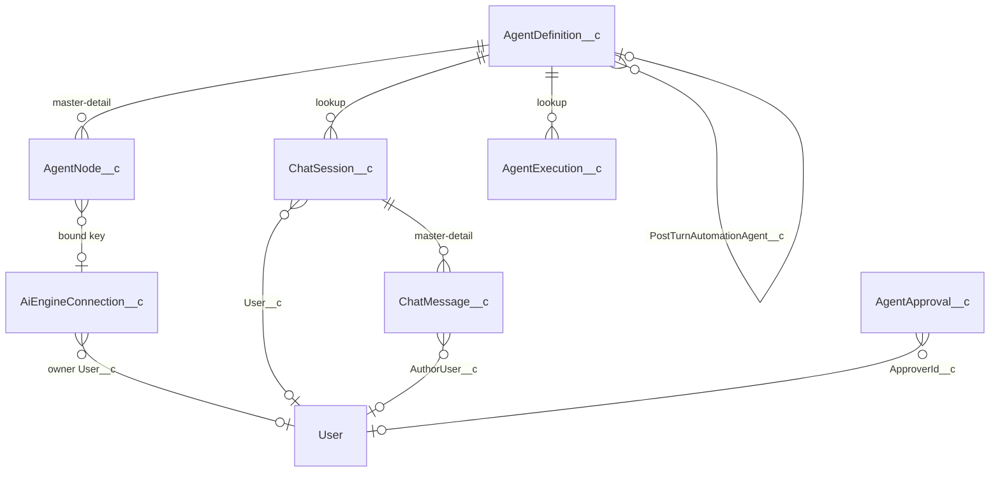

# Archon — Data Dictionary

| | |
|---|---|
| Document | 03 · Data dictionary |
| Product | Archon, by Aeventra AI |
| Version | 0.1, draft for review |
| Date | 24 October 2026 |
| Owner | Annu (sponsor and product owner) |
| Audience | Engineers, report builders, the security reviewer, and anyone answering "where does this value come from" |
| Traces to | [01 · Architecture](01-solution-architecture.md) section 8 (data architecture) |
| Sources | Field tables are generated from the metadata files under `force-app/main/default/objects` and from `server-langchain/prisma/schema.prisma` at commit 0f484b2 (Salesforce) and ad6eace (server). The "written by / read by" notes come from the code reading behind document 01. |

## 1. How to read this document

Two stores hold Archon's data. **Salesforce** holds everything the customer owns and reports on. **Postgres** on the server holds what the server needs to run. The architecture document explains the split; this one lists every field.

In a packaged org every custom object and field below carries the `archon__` namespace prefix (`archon__AgentDefinition__c`). The server detects the namespace per org and applies it through `pkgConn`; the React app strips the prefix from responses. Field names in this document are shown without the prefix.

Flags: *required*, *unique*, *external id*, *history* (field history tracking). For Postgres: *id*, *unique*, *default*, *optional*, index notes at the top of each table. A "purpose" cell that is empty means the metadata carries no description; the paragraph above the table says what the field is for.

## 2. Salesforce objects

### 2.1 Relationships

`AgentApproval__c` joins a paused run by `ApprovalToken__c`, not by a lookup. `AgentExecution__c.RecordId__c` and `ChatSession__c.RecordContextId__c` hold polymorphic record ids as text.

### 2.2 AgentDefinition__c

The agent. **Written by** the builder's save (`AgentBuilderRestService` → `AgentBuilderController.saveAgentWithNodes`), the Architect compiler (create and rebuild, `architect/compiler.ts`), the system-agent sync (`platform/system-agents.ts`), the status and streaming toggles (`AgentListRestService`), the copilot's `activate_agent` and `update_agent`, and the New Agent dialog (`createAgent`). **Read by** the server's agent cache (two SOQL queries, cached 60 s), every Apex chat and run entry point (status gate), the agents list, Home stats and the Conversations page. A system agent (`IsSystem__c`) is read-only in the builder and cannot be deleted.

Custom object · label “Agent Definition” · sharing Private · visibility Public.

| Field | Type | Flags | Purpose |
|---|---|---|---|
| `AccessMode__c` | Picklist · values: Org, PerUser (default Org) |  | How Salesforce tool calls authenticate for chat users. Org = everyone uses the Archon Setup org connection. PerUser = each user must connect their own Salesforce account once; tool calls run with their access and audit identity. |
| `ApiName__c` | Text · 255 chars | required, unique, external id |  |
| `CanvasJson__c` | LongTextArea · 131072 chars |  |  |
| `DebugMode__c` | Checkbox · default false |  | When on, every chat turn stores the complete raw request and response JSON sent to/from the AI provider on the resulting ChatMessage__c, for troubleshooting. Adds extra storage per turn — turn off when done. |
| `Department__c` | Text · 100 chars | required |  |
| `Description__c` | TextArea |  |  |
| `ExecuteType__c` | Picklist · values: Trigger, Chat, Both (default Trigger) |  | What kind of agent this is. Communication (API value Chat): talks with a person over web chat, WhatsApp or the Home copilot, keeps the conversation and stops at every reply. Automation (API value Trigger): runs in one go from a Flow, Apex or a schedule on a record and a payload, works until the goal is met and returns a result. Both: the same agent does both. The API values are unchanged so existing automations keep working. |
| `ExternalServerUrl__c` | Url |  |  |
| `IsSystem__c` | Checkbox · default false |  | Set by the platform on agents it ships and manages (for example the Archon Copilot). A built-in agent is read-only on the canvas and cannot be deleted — it can only be switched Active or Inactive. The platform rewrites its nodes when a new version ships. |
| `KnowledgeBase__c` | LongTextArea · 131072 chars |  |  |
| `PostTurnAutomationAgent__c` | Lookup · → AgentDefinition__c · SetNull |  | Optional. A Trigger/Both agent to automatically invoke (via AgentRunner.run, with the turn's transcript) after every chat turn on this agent. Lets a chat agent hand off to a paired automation agent without any agent-specific Apex — leave blank to opt out. |
| `SetupChecklistJson__c` | LongTextArea · 32768 chars |  | Populated when this agent was AI-generated — items the admin still needs to do by hand (connect a provider, bind an AI key, review a default). Rendered by the builder's setup-checklist panel. |
| `Status__c` | Picklist · values: Draft, Active, Inactive (default Draft) |  |  |
| `StreamReplies__c` | Checkbox · default false |  | Whether this agent's chats start with live streaming on: the tools it runs are narrated as they run, and the reply appears as it is written. Off by default. This is the starting point for a conversation, not a lock — anyone chatting can turn streaming on or off from the chat window, and their choice is remembered for that agent in that browser. |
| `SuccessRate__c` | Number · 5,2 · default 0 |  |  |
| `TotalExecutions__c` | Number · 10,0 · default 0 |  |  |
| `Version__c` | Number · 5,0 · default 1 |  |  |

### 2.3 AgentNode__c

One canvas node, master-detail to the agent. **Written by** the same save path and the compiler (a rebuild deletes and recreates nodes, keeping the bound key), the system-agent sync, `bindEngineConnectionToNode` (`AiEngineConnection__c`), and the copilot's `update_agent` and `add_agent_tool`. **Read by** the server when it loads an agent, by the builder, and by the Architect's `agent_details`. `ConfigJson__c` shapes are in section 3.

Custom object · label “Agent Node” · sharing ControlledByParent · visibility Public.

| Field | Type | Flags | Purpose |
|---|---|---|---|
| `AgentDefinition__c` | MasterDetail · → AgentDefinition__c |  |  |
| `AiEngineConnection__c` | Lookup · → AiEngineConnection__c · SetNull |  | Optional. The credential this AI node uses at runtime. Serves as the DEFAULT — the resolver still prefers the running user's own Preferred connection over this if present. |
| `ConfigJson__c` | LongTextArea · 32768 chars |  |  |
| `IsEnabled__c` | Checkbox · default true |  |  |
| `McpServer__c` | Text · 100 chars |  |  |
| `McpTool__c` | Text · 100 chars |  |  |
| `NodeSubType__c` | Text · 100 chars |  |  |
| `NodeType__c` | Picklist · values: trigger, ai, action, logic, email, sms, storage, end, catalog, subagent, tool, guardrail, automation | required |  |
| `PositionX__c` | Number · 6,0 · default 0 |  |  |
| `PositionY__c` | Number · 6,0 · default 0 |  |  |
| `SortOrder__c` | Number · 5,0 · default 0 |  |  |

### 2.4 ChatSession__c

One conversation. **Created by** `startSession` (Apex, from the app), `findOrCreateAutomatedSession` (the WhatsApp bridge and `AgentInvokeAction`), the WebSocket gateway when a socket has no session (`resolveWsChatSession`), and the revival initiator. **Updated by** the server's roll-up after each socket turn (activity, expiry, totals, title), Apex after each HTTP turn, the memory summariser and title generator (server, async), the handoff tool (server, status and `Handoff*` fields), the handoff service and REST (Apex, return and reply), the handoff poller (server), `endSession` and `discardIfEmpty` (Apex). The `ExpiresAt__c` description mentions a `ChatSessionExpirer` scheduled job; no such class exists today, so expiry is not applied automatically.

Custom object · label “Chat Session” · sharing Private. One conversation thread between a user and a chat-enabled agent. Sliding 24h expiry from last activity. Manually closeable via End button.

| Field | Type | Flags | Purpose |
|---|---|---|---|
| `ActiveTopic__c` | Text · 255 chars |  | Name of the Agent Topic this conversation is currently on. Persisted so the classifier biases toward staying put instead of re-deciding cold every turn. Blank when the agent has no Topics defined. |
| `AgentDefinition__c` | Lookup · → AgentDefinition__c · Restrict | required | Which agent this conversation is with. |
| `CachedTokens__c` | Number · 18,0 |  | Prompt-cache hits across every turn of this session, already counted inside TokensIn__c. |
| `Channel__c` | Text · 40 chars |  | Where this conversation is happening: whatsapp, sms, web, test. Forwarded to the agent so channel-specific instructions (e.g. a phone lookup) apply only where they can. Null means unknown; the agent is told no sender phone is available. |
| `Department__c` | Text · 100 chars |  | Copied from the agent at session creation. Lets admins build reports by department without joining to AgentDefinition__c. |
| `ExpiresAt__c` | DateTime |  | LastActivityAt + 24h. The ChatSessionExpirer scheduled Apex marks rows past this as Expired. |
| `HandedOffAt__c` | DateTime |  | When the agent handed this conversation to a person. |
| `HandoffAssigneeId__c` | Text · 18 chars |  | The User, Queue or Group the conversation was handed to. |
| `HandoffAssigneeLabel__c` | Text · 255 chars |  | The name of who has the conversation, as shown to people and to the agent. |
| `HandoffAssigneeType__c` | Text · 40 chars |  | owner, queue, user, group or omni — who the handoff node said takes over. |
| `HandoffNotify__c` | Text · 40 chars |  | How the person was told: notification, email, or both. |
| `HandoffPreviousOwner__c` | Text · 18 chars |  | The owner before the handoff changed it, restored when the conversation returns. |
| `HandoffReason__c` | Text · 255 chars |  | Why the agent handed this conversation to a person, in the agent's words. |
| `HandoffReturnAt__c` | DateTime |  | When the conversation goes back to the agent on its own, if nobody writes before then. Cleared when it returns. |
| `HandoffReturnHours__c` | Number · 5,0 |  | Hours of quiet before a handed-off conversation returns to the agent, copied from the handoff node. |
| `HandoffReturnLine__c` | Text · 255 chars |  | What the customer hears when the conversation returns to the agent; blank for a silent return. |
| `HandoffReturnNote__c` | TextArea |  | What the person wanted the agent to know when they gave the conversation back; the agent reads it on its next turn. |
| `HandoffReturnedBy__c` | Text · 18 chars |  | The User who gave the conversation back, or blank when the quiet period did. |
| `LastActivityAt__c` | DateTime |  | Updated on every turn. Drives the sliding 24h expiry. |
| `LatencyMsTotal__c` | Number · 18,0 |  | Sum of every turn's server-side latency in this session. Divided by TotalTurns__c it gives the session's average response time. |
| `MemoryCoveredCount__c` | Number · 9,0 |  | How many leading history messages MemorySummary__c covers. The server sends summary + history[coveredCount..] so summary and raw window always cover the full conversation with no gap. |
| `MemoryFactsJson__c` | LongTextArea · 32768 chars |  | Structured session scratchpad (verified identity, exact record Ids, amounts, rejected offers) maintained alongside MemorySummary__c. Pinned into every turn's system prompt so exact values survive summarization. |
| `MemorySummary__c` | LongTextArea · 32768 chars |  | Running LLM-maintained summary of older turns (the "CONVERSATION SO FAR" block). Written asynchronously by the Node server after replies; sent to the model in place of raw history once the conversation passes the length threshold. |
| `PendingApprovalToken__c` | Text · 64 chars |  | Server-issued approval token when the AI proposed a write tool. Cleared after the user Approves or Declines. Survives LWC page refresh so the modal can resume. |
| `RecordContextId__c` | Text · 18 chars |  | Optional SF record Id that the chat is anchored to (embedded widget mode). Null in standalone tab mode. |
| `RecordContextType__c` | Text · 80 chars |  | SObject API name of the record this chat is anchored to (e.g. Account, Lead). Null in standalone tab mode. |
| `SenderPhone__c` | Phone |  | The phone number the customer is messaging from, when the channel knows it (WhatsApp does; the Testing tab does not). Forwarded to the agent as a fact on every turn so it never guesses a number or asks for one it already has. Set by the integration that opens the session. |
| `Status__c` | Picklist · values: Active, Handed off, Ended, Expired (default Active) |  |  |
| `TitleGeneratedByAi__c` | Checkbox · default false |  | True when the session Title was produced by the auto-title generator. Distinguishes AI-generated titles from user-set ones so the generator doesn't overwrite manual titles. |
| `Title__c` | Text · 120 chars |  | Auto-derived from first user message (truncated). Editable later. |
| `TokensIn__c` | Number · 10,0 · default 0 |  | Sum of input tokens consumed by the LLM across all turns in this session. |
| `TokensOut__c` | Number · 10,0 · default 0 |  | Sum of output tokens generated by the LLM across all turns in this session. |
| `TotalTurns__c` | Number · 6,0 · default 0 |  | Number of user turns sent in this session. |
| `UsageByModelJson__c` | LongTextArea · 32768 chars |  | Running per-model totals for the whole session: [{model, calls, tokensIn, tokensOut, cacheRead}], merged from each turn's ChatMessage__c.UsageJson__c. Held at session level so usage-by-model reporting needs only the session list, not a scan of every message. |
| `User__c` | Lookup · → User · SetNull |  | The user who started this conversation. Immutable — survives OwnerId transfers so reporting stays accurate. |

### 2.5 ChatMessage__c

One line of a transcript, master-detail to the session. **Written by** Apex `sendTurn` on the HTTP path (user, tool and assistant rows, with `PhaseMsJson__c`), the server's `recordWsTurn` on the socket path, the approval audit (server, System rows), the handoff handler (Apex, System rows), background follow-up notes (server, System rows), `replyAsHuman` (Apex, Human rows with `AuthorUser__c`), `recordCustomerMessage` (Apex, User rows while handed off), and `feedback` (Apex). **Read by** the history loader before every turn (`Human` rows are mapped to the assistant side with a colleague prefix; `System` handoff and approval lines become `[HANDED OFF]`, `[BACK FROM A PERSON]` and `[APPROVAL OUTCOME]` lines), the guardrail sum (server, Assistant rows since the start of the day and month), the Conversations, Trace and Cost pages, Home stats, and the memory summariser.

Custom object · label “Chat Message” · sharing ControlledByParent. One message within a Chat Session. Sharing inherited from parent session.

| Field | Type | Flags | Purpose |
|---|---|---|---|
| `ApprovalStatus__c` | Picklist · values: NotRequired, Pending, Approved, Declined (default NotRequired) |  |  |
| `ApprovedAt__c` | DateTime |  | Timestamp when the chatter clicked Approve on the approval modal. Null if Declined or not required. |
| `AttachedContentDocumentIds__c` | LongTextArea · 32768 chars |  | Comma-separated ContentDocumentIds attached to this user message. LWC uploads to Salesforce Files, sendTurn persists IDs here, and the Node server fetches the bytes to include in the LLM turn. |
| `AuthorUser__c` | Lookup · → User · SetNull |  | The person who wrote this message while the conversation was handed off to them (Role = Human). |
| `CachedTokens__c` | Number · 18,0 |  | Prompt-cache hits across this turn, already counted inside TokensIn__c. Broken out because providers bill cache reads far cheaper than fresh input, so a turn with a high cached share costs much less than its raw token count suggests. |
| `ChatSession__c` | MasterDetail · → ChatSession__c |  |  |
| `Content__c` | LongTextArea · 131072 chars |  | Plain-text body of the message. Tool messages store the raw tool response as JSON text. |
| `Feedback__c` | Text · 8 chars |  | End-user reaction to this assistant message: 'up' or 'down' (empty = none). Set from the chat panel's thumbs; reviewable per agent to find replies that need improving. |
| `LatencyMs__c` | Number · 18,0 |  | Server-side wall-clock time for the whole turn, in milliseconds — every model call, tool call and guardrail pass it contained. Measured by the agent server and returned with the turn, so it excludes Salesforce callout overhead. |
| `ModelUsed__c` | Text · 60 chars |  | Which LLM produced this turn (e.g. gpt-4o, claude-opus-4-7). Useful for cost / quality analytics. |
| `PhaseMsJson__c` | LongTextArea · 4096 chars |  | Where this turn's server-side time went: {turnMs, setup, resolveServers, loadTools, buildPrompt, modelLoop}. LatencyMs__c is the modelLoop phase only — it starts after setup, MCP tool loading and prompt building have already run, so a turn reporting 888ms had really taken 9.5s and the difference was invisible from either end. turnMs is the whole server-side turn; the caller's wall clock minus turnMs is network and persistence. Only populated on Role = Assistant. |
| `RequestPayload__c` | LongTextArea · 131072 chars |  | Raw JSON request body sent to the AI provider for this turn. Only populated when the agent's Debug Mode is on. Truncated if it exceeds field length. |
| `RequiredApproval__c` | Checkbox · default false |  | True when this is a Tool-role message that needed user approval before running (e.g. a write tool). |
| `ResponsePayload__c` | LongTextArea · 131072 chars |  | Raw JSON response body received from the AI provider for this turn. Only populated when the agent's Debug Mode is on. Truncated if it exceeds field length. |
| `Role__c` | Picklist · values: User, Assistant, Tool, System, Human | required |  |
| `Sensitive__c` | Checkbox · default false |  | True when this message body includes record data the AI fetched. Lets admins filter sensitive content out of certain reports. |
| `SequenceNumber__c` | Number · 6,0 | required | Monotonic ordering within a session. CreatedDate is only second-precision, so we use this for tie-breaking when multiple messages land in the same second (e.g. user message + assistant message + tool messages from one turn). |
| `TokensIn__c` | Number · 8,0 |  |  |
| `TokensOut__c` | Number · 8,0 |  |  |
| `ToolCallsJson__c` | LongTextArea · 32768 chars |  | JSON array of tool calls the assistant proposed in this turn. Only populated when Role = Assistant. |
| `ToolResultsJson__c` | LongTextArea · 32768 chars |  | JSON payload returned by the tool after execution. Only populated when Role = Tool. |
| `TurnStatus__c` | Picklist · values: Complete, Failed |  | Whether the turn that produced this assistant message completed or failed. Blank on rows written before the field existed — read as Complete. Failed turns are recorded so dashboards can count them; before this, a failed chat turn left no trace in Salesforce at all. |
| `UsageJson__c` | LongTextArea · 32768 chars |  | Per-model token breakdown for this turn: [{model, stages, calls, tokensIn, tokensOut, cacheRead}]. A turn is not one model call — the router, a specialist subagent, and utility passes can each run on a different model. ModelUsed__c names only the model that produced the reply, so it cannot describe a multi-model turn; these entries sum back to TokensIn__c/TokensOut__c. Only populated on Role = Assistant. |

### 2.6 AgentExecution__c

One automation run. **Written by** Apex when a run is started (`AgentRunner.run` and `AgentBuilderController.executeAgent` insert the log) and by the server's callback, which upserts on `CorrelationId__c` after an asynchronous completion or a resume. Today an asynchronous run produces two rows because the acknowledgement id and the run id differ (architecture gap 1). **Read by** the Executions page, Home stats and the agents' activity counts.

Custom object · label “Agent Execution” · sharing ReadWrite.

| Field | Type | Flags | Purpose |
|---|---|---|---|
| `AgentDefinition__c` | Lookup · → AgentDefinition__c |  |  |
| `CorrelationId__c` | Text · 50 chars | unique, external id |  |
| `RecordId__c` | Text · 18 chars |  |  |
| `Status__c` | Picklist · values: QUEUED, RUNNING, SUCCESS, ERROR, TIMEOUT, WAITING, WAITING_APPROVAL (default QUEUED) |  |  |
| `AgentScore__c` | Number · 5,0 |  |  |
| `AgentPriority__c` | Text · 50 chars |  |  |
| `AgentReason__c` | LongTextArea · 32768 chars |  |  |
| `ToolsUsed__c` | Text · 255 chars |  |  |
| `ExecutionMs__c` | Number · 8,0 |  |  |
| `InputPayload__c` | LongTextArea · 32768 chars |  |  |
| `OutputPayload__c` | LongTextArea · 32768 chars |  |  |
| `ErrorMessage__c` | LongTextArea · 32768 chars |  |  |
| `Department__c` | Text · 100 chars |  |  |
| `RunMode__c` | Text · 20 chars |  |  |

### 2.7 AgentApproval__c

One paused automation approval. **Nothing in the product inserts rows today**: the only `insert` of this object is in `AgentApprovalControllerTest`. The server's `approval` node submits a Salesforce approval process on the record and pauses the run with a token in `AgentRun`; `AgentApprovalController.decide` **updates** a row (status, approver, comments, decision time) and calls `POST /api/agent/runs/resume`, and the Approvals page and the copilot's `list_approvals` **read** rows. Until something creates the row when a run pauses, the automation approval path depends on the customer's own automation calling the resume endpoint (architecture gap 21, requirement R1.12). The run poller auto-rejects by the server's `AgentRun.timeoutAt`, not by this object.

Custom object · label “Agent Approval” · sharing ReadWrite.

| Field | Type | Flags | Purpose |
|---|---|---|---|
| `AgentRunId__c` | Text · 60 chars |  | The Archon server's AgentRun.id — the paused execution this decision resumes. |
| `AgentApiName__c` | Text · 255 chars |  |  |
| `NodeLabel__c` | Text · 255 chars |  |  |
| `RecordId__c` | Text · 18 chars |  |  |
| `ApproverId__c` | Lookup · → User · SetNull |  |  |
| `Status__c` | Picklist · values: Pending, Approved, Rejected, TimedOut (default Pending) | required |  |
| `ApprovalToken__c` | Text · 60 chars | unique | Matches the Archon server's AgentRun.approvalToken — the join key used to resume. |
| `Comments__c` | LongTextArea · 4096 chars |  |  |
| `TimeoutAt__c` | DateTime |  |  |
| `DecidedAt__c` | DateTime |  |  |

### 2.8 AiEngineConnection__c

One AI provider key. **Written by** `AiEngineConnectionController` (save, delete, bind, fetch models, validate, set embedding key). **Read by** the `KeyReader` inner class (`without sharing`) when Apex needs an agent's bound key for a ticket, a turn or a run, by the server's Architect specialists and system-agent sync through `pkgConn` (preferred, active, validated), by the mobile routes, and by the knowledge-base indexer for the embedding key (`UsedForEmbeddings__c`). `ApiKey__c` is EncryptedText; `ViewEncryptedData` is granted to both permission sets so the controllers can read it.

Custom object · label “AI Engine Connection” · sharing Private · visibility Public. Stores API credentials for an AI engine (Claude, OpenAI, Gemini). Two ownership modes: Personal (owner-only) or Shared (admin-managed, granted via native record sharing). ApiKey is encrypted at rest; only users with 'View Encrypted Data' can see the plaintext.

| Field | Type | Flags | Purpose |
|---|---|---|---|
| `ApiKey__c` | EncryptedText · 175 chars | required | The API key for the AI engine. Encrypted at rest (AES-256) and masked in the UI. Users need the 'View Encrypted Data' permission to see the plaintext. Only accessible to the connection owner (Personal) or users granted access (Shared). |
| `AvailableModelsJson__c` | LongTextArea · 32768 chars |  | JSON array of model ids enabled for this connection (e.g. ["gpt-4o","gpt-4o-mini"]). Empty = provider defaults. Managed from the AI Models page; read by every model picker. |
| `DefaultModel__c` | Text · 80 chars |  | Optional. Specific model name to use, e.g. claude-sonnet-4-6, gpt-4o, gemini-1.5-pro. Leave blank to let each agent's AI node pick. |
| `Endpoint__c` | Url |  | Optional. Override the default provider endpoint (e.g., Azure OpenAI, self-hosted proxy). Leave blank to use the provider's standard URL. |
| `EngineType__c` | Picklist · values: claude, openai, gemini, custom · restricted | required | Which AI engine this credential is for. Determines which API endpoint the Node server will call. |
| `IsActive__c` | Checkbox · default true |  | When false, this connection is ignored by the runtime resolver. Use to temporarily disable a key without deleting the record. |
| `IsPreferred__c` | Checkbox · default false |  | When true, this connection is preferred over other connections of the same engine type for the running user. Only one connection per user per engine should be Preferred; the Apex controller enforces this. |
| `IsPublicShared__c` | Checkbox · default false |  | Admin-only. When true on a Shared connection, an Apex trigger grants Read access to every user in the org. When false, use the standard Sharing button to grant individual users/roles. |
| `Label__c` | Text · 80 chars | required | User-facing name for this connection, e.g. "My Claude Key" or "Team Anthropic (prod)". |
| `LastUsedAt__c` | DateTime |  | Timestamp of the most recent successful chat turn that used this connection. Updated by the Node server after each successful LLM call. |
| `LastValidatedAt__c` | DateTime |  | Timestamp of the most recent successful Test Connection. Null means the key has never been validated. |
| `Notes__c` | LongTextArea · 32000 chars |  | Free-form notes about this connection (rotation date, billing owner, purpose). |
| `OwnershipType__c` | Picklist · values: Personal, Shared (default Personal) · restricted | required | Personal = only the owner can use this connection. Shared = admin manages sharing via the standard Sharing button (or the IsPublicShared__c flag for org-wide). |
| `UsedForEmbeddings__c` | Checkbox · default false |  | The one key the org embeds knowledge-base documents and questions with. Embeddings must share a single model across agents, so this is org-wide, not per agent; only one connection may carry it, and the Apex controller enforces that. OpenAI only. |
| `User__c` | Lookup · → User · SetNull |  | The user this connection belongs to. Denormalized from OwnerId for reporting and quick queries. For Shared connections, this is the admin who created it. Populated by Apex on insert; SetNull if the referenced User is deleted (Salesforce requires SetNull for User lookups). |
| `ValidationStatus__c` | Picklist · values: Untested, Success, Failed (default Untested) · restricted |  | Result of the most recent Test Connection call. Displayed as a badge in the picker UI. |

### 2.9 CustomMcpServer__c

An admin-added connector server. **Written by** `AgentConnectorController.saveCustomMcpServer` and the delete action. **Read by** the connectors directory, the wake service, the server's tool-node connector resolution (cached 5 minutes) and the Architect survey.

Custom object · label “Custom MCP Server” · sharing Read · visibility Public. User/client-added custom MCP servers — an open extension point alongside the packaged (protected) ConnectorCatalog__mdt. Same pattern Claude uses for adding a custom MCP server URL. Public Read Only: everyone can see and use a custom server once added; only builders (AgentBuilderUser) can add/edit/remove one.

| Field | Type | Flags | Purpose |
|---|---|---|---|
| `AuthStyle__c` | Text · 40 chars |  | How Archon authenticates to this server: none, api-key, mcp-oauth (OAuth discovered from the server per the MCP spec), or provider-token:<salesforce_mcp\|gmail\|outlook> (a connection's token passed through). |
| `CatalogType__c` | Text · 40 chars | required | Same values as ConnectorCatalog__mdt.MapsToCatalogType__c (salesforce_crm_tools/storage_tools/email_tools/channel_tools) — determines which tool schema set the AI sees for this server. |
| `Category__c` | Text · 40 chars | required | Same free-text category values used by ConnectorCatalog__mdt.Category__c (Storage/Email/Channels/CRM/Productivity) — keeps custom servers filterable in the same directory UI. |
| `Description__c` | LongTextArea · 1000 chars |  |  |
| `IsActive__c` | Checkbox · default true |  |  |
| `McpServerUrl__c` | Url | required | The custom MCP server's base URL — same as adding a custom MCP server in Claude's own connector settings. |
| `PrincipalTypes__c` | Text · 60 chars |  | Comma-separated principal types this server admits: org, group, user. Empty means org only. |

### 2.10 AgentKbChunk__c

Knowledge chunks for the Salesforce knowledge-base backend. **Written and read only by** the server (`kb/backends/salesforce.ts` through `pkgConn`): the indexer inserts chunks, retrieval runs a SOSL `FIND` over `Content__c`. No Apex references it; the Archon Admin permission set grants full access.

Custom object · label “Agent KB Chunk” · sharing ReadWrite.

| Field | Type | Flags | Purpose |
|---|---|---|---|
| `AgentApiName__c` | Text · 255 chars | required |  |
| `DocumentExternalId__c` | Text · 255 chars | required | The Archon server's KbDocument.id — groups chunks belonging to the same uploaded document. |
| `DocumentTitle__c` | Text · 255 chars |  |  |
| `ChunkIndex__c` | Number · 8,0 · default 0 |  |  |
| `Content__c` | LongTextArea · 131072 chars |  |  |

### 2.11 ArchonInstall__c (hierarchy custom setting)

The org's credential for the server. **Written by** `ArchonSetupController` (start, refresh status, reset). **Read by** `ArchonServerClient` and the duplicate helpers in the chat, connector, user-connection, WebSocket, artifact and system-agent classes. Visibility is Public today; the security review will want Protected (requirement R1.3).

Hierarchy custom setting · label “Archon Install” · visibility Public. Org-level Archon Setup state. Holds the sessionKey the Apex layer sends as Bearer when calling the Archon Node server.

| Field | Type | Flags | Purpose |
|---|---|---|---|
| `ConfiguredAt__c` | DateTime |  |  |
| `ConfiguredByEmail__c` | Email |  | Email of the SF user who completed setup. Shown on the Setup page so admins can tell whose tokens the server is holding. |
| `SessionKey__c` | Text · 120 chars |  | Server-issued long-lived Bearer token used by all Apex callouts to the Archon Node server. Minted by /api/setup/pickup. |

### 2.12 AgentGuardrails__c (hierarchy custom setting)

The org-wide token cap. **Written by** `AgentGuardrailsController`. **Read by** Apex `enforceBeforeTurn` on the HTTP path and the server's `checkGuardrails` on the socket path (cached 60 s).

Hierarchy custom setting · label “Archon Guardrails” · visibility Public. Org-wide chat token guardrail — a hard cap on total chat-mode AI usage (all agents combined) per day/month, checked before every turn.

| Field | Type | Flags | Purpose |
|---|---|---|---|
| `IsEnabled__c` | Checkbox · default false |  | Master switch. When off, no cap is enforced regardless of the values below. |
| `MaxTokensPerDay__c` | Number · 18,0 |  | Combined input+output tokens across all chat-mode agents allowed per rolling calendar day. Blank = no daily cap. |
| `MaxTokensPerMonth__c` | Number · 18,0 |  | Combined input+output tokens across all chat-mode agents allowed per calendar month. Blank = no monthly cap. |

### 2.13 ArchonConfig__mdt (custom metadata)

Deployed configuration. **Read by** `ArchonServerClient` (`ServerUrl__c`). `JwtSecret__c` is read by nothing, is stripped by the package build, and the committed record carries a value that should be removed (requirement R1.2).

Custom metadata type · label “Archon Config” · visibility Public.

| Field | Type | Flags | Purpose |
|---|---|---|---|
| `JwtSecret__c` | Text · 255 chars |  | HMAC-SHA256 secret used to sign JWTs sent to the Archon AI execution server. Must match server/.env JWT_SECRET. |
| `ServerUrl__c` | Url |  | Public URL of the Archon Node server. Used by Apex callouts. No trailing slash. Must also have a matching Remote Site Setting. |

### 2.14 ConnectorCatalog__mdt (custom metadata)

The packaged connector directory, nine records: `salesforce_mcp`, `salesforce_metadata`, `gmail`, `outlook`, `gdrive`, `onedrive`, `sharepoint`, `slack`, `teams`. **Read by** the connectors directory, the wake service, the server's tool-node connector resolution, the Architect survey and the automation `call_tool` node. The last four records have no server URL yet.

Custom metadata type · label “Connector Catalog” · visibility Public.

| Field | Type | Flags | Purpose |
|---|---|---|---|
| `AuthType__c` | Text · 40 chars | required |  |
| `AuthorizeUrl__c` | Url |  |  |
| `BrandColor__c` | Text · 16 chars |  | Hex color used as the card icon background tint. |
| `Category__c` | Text · 40 chars | required |  |
| `Description__c` | LongTextArea · 1024 chars |  |  |
| `DisplayName__c` | Text · 80 chars | required |  |
| `IconStaticResource__c` | Text · 120 chars |  | Name of the static resource holding the SVG icon for this connector. |
| `IsPopular__c` | Checkbox · default false |  |  |
| `MapsToCatalogType__c` | Text · 60 chars | required | Which AgentNode catalog sub-type this connector powers (salesforce_crm_tools, storage_tools, email_tools, channel_tools). |
| `McpServerUrl__c` | Text · 255 chars |  | Base URL of this provider's standalone MCP server (no trailing slash, no /mcp suffix). Used for the design-time GET /tools catalog fetch and sent to the Node companion each chat turn so the LLM's Managed MCP points at the right server. |
| `Scopes__c` | Text · 255 chars |  |  |
| `SortOrder__c` | Number · 4,0 · default 100 |  |  |
| `TokenUrl__c` | Url |  |  |

### 2.15 Fields on standard objects (demo agents, excluded from the package)

**Lead** — collected by the WhatsApp intake agent; the `LeadStatus` standard value set adds "WhatsApp Qualified" and "Lost Lead"; the `LeadQualificationFields` permission set grants them.

Standard object (custom fields only).

| Field | Type | Flags | Purpose |
|---|---|---|---|
| `Budget__c` | Picklist · values: 50L - 1Cr, 1Cr - 2Cr, 2Cr - 5Cr, 5Cr+ · restricted |  | The budget band the lead selected. Collected after the project is identified, and never required to qualify a lead. |
| `Project_Name__c` | Picklist · values: Villa Project A, Villa Project B, Villa Project C, Apartment Project A, Apartment Project B, Commercial Project A, Commercial Project B, Other Project A · restricted |  | The specific project the lead is interested in. DEPENDENT on Project Type: only the projects belonging to the chosen type are offered, which is what lets a valid project name imply its type. Values here are placeholders in the shape of the requirement's example — replace them with the real project list. |
| `Project_Type__c` | Picklist · values: Villa, Apartment, Commercial, Other · restricted |  | The kind of property the lead is interested in. Controls which Project Names are offered — Project Name is a dependent picklist on this field. |

**Opportunity** — used by the revival agent; the validation rule requires a loss reason when Closed Lost.

Standard object (custom fields only). Validation rules: `Requires_Loss_Reason_When_Closed_Lost`.

| Field | Type | Flags | Purpose |
|---|---|---|---|
| `CompetitorIntel__c` | LongTextArea · 32768 chars |  | CLIENT-ORG CUSTOMIZATION (not part of the packaged app). Competitive intelligence captured by the AI revival agent during negotiations — one line per vendor the customer mentions: "Vendor: name \| Price: amount \| Includes: details \| Captured: date". Appended, never overwritten. |
| `Loss_Reason__c` | Picklist · values: Price, Competitor, No Budget, Timing / No Decision, Product Fit, No Response, Other |  | Why this deal was lost. Required when Stage is Closed Lost (see the Opportunity_Requires_Loss_Reason validation rule) — referenced by the WhatsApp lost-opportunity revival agent. |

**Account** — set by the Closed Lost revival flow.

Standard object (custom fields only).

| Field | Type | Flags | Purpose |
|---|---|---|---|
| `Latest_closed_opp__c` | Text · 255 chars |  | Name of the most recently Closed Lost Opportunity on this account. Populated by the Opportunity Closed Lost Revival flow; referenced by the WhatsApp revival outreach template. |

**Product2** — the revival agent's discount authority.

Standard object (custom fields only).

| Field | Type | Flags | Purpose |
|---|---|---|---|
| `MaxDiscountPercent__c` | Percent · 5,2 |  | CLIENT-ORG CUSTOMIZATION (not part of the packaged app). Per-product discount authority for the AI revival agent: the highest discount the agent may self-approve on this product. The server computes each deal's floor price deterministically from this field (list price x (1 - max %)) — the agent never does the math itself. Empty defaults to 15%. |

## 3. JSON fields and their shapes

| Field | Shape | Written by |
|---|---|---|
| `AgentDefinition__c.CanvasJson__c` | `{connections:[{id?, fromIndex, fromPort, toIndex, toPort}], spec?:{lifecycle, architecture, trigger}, system?:{apiName, version}, viewport?}`; connections are keyed by node position in the sorted `AgentNode__c` list; `fromPort` defaults to `out`; a missing id becomes `e{from}:{port}-{to}:{port}` | builder save, compiler, system-agent sync |
| `AgentDefinition__c.SetupChecklistJson__c` | `[{title, description, category: connector \| ai_engine \| review \| knowledge_base \| other, done}]` | Architect gaps stage, builder save |
| `AgentNode__c.ConfigJson__c` (ai) | `systemPrompt`, `instruction`, `model`, `answerStyle`, `thinkingEffort`, `maxReplyTokens`, `fewShotExamples`, `useKnowledgeBase`, `budgets{maxTokens, maxMs, maxSteps}`, `customerFacing`, `bannedPhrases`, `phraseReplacements`, `guardrails{…}`; AI step adds `step:true`, `outputs:[{name, type, options, description}]`, `outputVariable` | builder, compiler, copilot `update_agent` |
| `ConfigJson__c` (subagent) | `routingDescription`, `systemPrompt`, `model`, `mode: transfer \| call`, `contextPolicy: isolated \| windowed \| full` | same |
| `ConfigJson__c` (tool) | `actionType: MCP \| Apex \| Flow \| Prebuilt \| Handoff`, `toolName`, `connectorId`, `parameterSchema`, `requiresApproval`, `runInBackground`; Prebuilt: `operation`, `object`, `selectedFields`, `boundFields`; Handoff: `whoTakesOver`, `assigneeId`, `assigneeLabel`, `routeRelated`, `notifyNotification`, `notifyEmail`, `returnAfterHours`, `customerLineOnHandoff`, `customerLineOnReturn` | same |
| `ConfigJson__c` (catalog) | `provider`, `connectorId`, `allowedTools`, `customTools`, `runAs: user \| group \| org \| connection`, `fallback`, `required`, `automationRunAs`, `allowedDomain`, `backgroundTools` | same |
| `ConfigJson__c` (logic, action, trigger) | if_else `condition`; loop `collectionVar`, `iteratorVar`, `maxIterations`; wait `seconds`; approval `timeoutHours`; set_variable `alias`; actions `object`, `recordId`, `fieldMappings`, `query`; call_tool `connectorId`, `toolName`, `args` | builder, compiler |
| `ChatSession__c.MemoryFactsJson__c` | a list of short facts the summariser kept; `MemorySummary__c` is prose; `MemoryCoveredCount__c` says how many messages they cover | server memory updater |
| `ChatSession__c.UsageByModelJson__c` | `{<model>: {tokensIn, tokensOut, cached, calls}}` totals | server roll-up |
| `ChatMessage__c.ToolCallsJson__c` | Tool rows: `{id, name, args}`; System rows: an audit record (`{kind:'approval', decision, decidedByName, tool, args, status}`) or a handoff record (`{kind:'handoff' \| 'handoff_return', …}`) | server, Apex handoff handler |
| `ChatMessage__c.ToolResultsJson__c` | the whole call: `{id, name, input, output, isError, serverName, ranAs?, nested?[]}`; large outputs are artifact previews fetched in full by id | server, Apex |
| `ChatMessage__c.PhaseMsJson__c` | `{preTurn?, setup, resolveServers, "servers.token", "servers.awake", "servers.catalog", loadTools, "background.await", buildPrompt, modelLoop, route?, turnMs, warnings[]}`, capped at 4096 characters | server (socket), Apex (HTTP) |
| `ChatMessage__c.UsageJson__c` | `usage[]` per model call: model, tokens in, out, cached | same |
| `ChatMessage__c.RequestPayload__c`, `ResponsePayload__c` | raw request and response when `DebugMode__c` is on; shown on the Trace page | Apex |
| `AgentExecution__c.InputPayload__c`, `OutputPayload__c` | the trigger payload sent to the run; the run's output map (cut at 32,000 characters) | Apex, server callback |
| `AiEngineConnection__c.AvailableModelsJson__c` | the provider's model list fetched by `fetchModels` | Apex |

## 4. Postgres models

All tables are per org (`orgId`) unless noted. Secrets marked *sealed* are AES-256-GCM under `ENCRYPTION_KEY`.

### 4.1 OrgInstall

One row per org that finished Setup. **Written by** the Setup callback and the token refresher. **Read by** `sessionAuth` on every request and by the per-org connection. Tokens sealed; the session key is a plain lookup column.

| Column | Type | Flags | Note |
|---|---|---|---|
| `orgId` | String | id | SF org Id (15/18 char) |
| `sessionKey` | String | unique |  |
| `sfAccessToken` | String |  |  |
| `sfRefreshToken` | String | optional |  |
| `sfInstanceUrl` | String |  |  |
| `sfUserId` | String | optional | user who completed setup |
| `sfUserEmail` | String | optional |  |
| `tokenExpiresAt` | DateTime | optional |  |
| `scopes` | String | optional |  |
| `configuredAt` | DateTime | default now( |  |
| `updatedAt` | DateTime | auto-updated |  |

### 4.2 PendingSetup

One Setup attempt. Written at `authorize-url`, deleted at the callback, swept after 10 minutes.

Indexes: index on orgId.

| Column | Type | Flags | Note |
|---|---|---|---|
| `state` | String | id | UUID we put in the authorize URL |
| `orgId` | String |  | SF org Id of the admin who started setup |
| `userId` | String |  |  |
| `returnUrl` | String |  | Lightning page to send the user back to |
| `sessionKey` | String |  | pre-minted; promoted to OrgInstall on success |
| `codeVerifier` | String | optional | PKCE verifier; null for a setup started before PKCE |
| `createdAt` | DateTime | default now( |  |

### 4.3 Connector

A connected account per org × provider × principal. **Written by** the OAuth callbacks, the mobile callback, disconnect (tokens nulled, row kept) and the token freshener. **Read by** the identity resolver, the directory and roster routes, the chat gate. Tokens and API key sealed.

Indexes: index on orgId; index on orgId, providerKey, principalType, subjectKey.

| Column | Type | Flags | Note |
|---|---|---|---|
| `id` | String | id, default uuid( |  |
| `orgId` | String |  | 15/18 char SF org Id |
| `providerKey` | String |  | 'salesforce_mcp' for now; gdrive/slack/... later |
| `displayName` | String |  |  |
| `status` | String | default "Pending" | Pending / Connected / Disconnected / Error |
| `authType` | String | default "OAuth2" | OAuth2 / ApiKey / ClientCredentials |
| `accessToken` | String | optional |  |
| `refreshToken` | String | optional |  |
| `tokenExpiresAt` | DateTime | optional |  |
| `scopes` | String | optional |  |
| `instanceUrl` | String | optional | SF-specific — token response includes it |
| `accountEmail` | String | optional |  |
| `externalAccountId` | String | optional | SF user id parsed out of the `id` URL |
| `apiKey` | String | optional | For ApiKey-auth providers (not used by SF MCP) |
| `configuredBy` | String | optional | SF user id |
| `lastConnectedAt` | DateTime | optional |  |
| `lastErrorMessage` | String | optional |  |
| `configJson` | String | optional | free-form provider extras |
| `principalType` | String | default "org" |  |
| `subjectType` | String | optional | 'user' \| 'permissionSet' \| 'publicGroup' \| 'department' |
| `subjectKey` | String | optional | SF user id · PermissionSet/Group Id · Department value |
| `subjectLabel` | String | optional |  |
| `createdAt` | DateTime | default now( |  |
| `updatedAt` | DateTime | auto-updated |  |

### 4.4 OrgIdentityPolicy

The org's defaults for who tools run as. Written by `PUT /api/connectors/policy`; read by the resolver (cached 60 s).

| Column | Type | Flags | Note |
|---|---|---|---|
| `orgId` | String | id |  |
| `defaultRunAs` | String | default "user" | user \| group \| org |
| `defaultFallback` | String | default "none" | none \| org |
| `blockOrgFallbackForChat` | Boolean | default true |  |
| `groupKeyType` | String | default "permissionSet" | permissionSet \| publicGroup \| department |
| `sfJwtEnabled` | Boolean | default false |  |
| `allowedDomainsJson` | String | optional | JSON string[] of sign-in domains |
| `reminderEveryDays` | Int | default 3 |  |
| `reminderMax` | Int | default 3 |  |
| `updatedAt` | DateTime | auto-updated |  |

### 4.5 ConnectorServerOverride

An admin's URL and key override for a connector server. Written by the identity routes; only `mcpServerUrl` is applied at runtime; `apiKey` sealed on write, not covered by the backfill script.

Indexes: unique on orgId, providerKey.

| Column | Type | Flags | Note |
|---|---|---|---|
| `id` | String | id, default uuid( |  |
| `orgId` | String |  |  |
| `providerKey` | String |  |  |
| `mcpServerUrl` | String |  |  |
| `authStyle` | String | default "provider-token" | provider-token \| mcp-oauth \| api-key \| salesforce-session \| none |
| `apiKey` | String | optional | sealed |
| `updatedBy` | String | optional |  |
| `updatedAt` | DateTime | auto-updated |  |

### 4.6 ConnectionReminder

How many reminders a person received for a provider. Written by `POST /api/connectors/reminders` (Apex sends the email and notification); no sweep.

Indexes: unique on orgId, providerKey, userId.

| Column | Type | Flags | Note |
|---|---|---|---|
| `id` | String | id, default uuid( |  |
| `orgId` | String |  |  |
| `providerKey` | String |  |  |
| `userId` | String |  |  |
| `agentApiName` | String | optional |  |
| `channel` | String | default "email" |  |
| `count` | Int | default 1 |  |
| `firstSentAt` | DateTime | default now( |  |
| `lastSentAt` | DateTime | default now( |  |

### 4.7 PendingOAuth

A connector OAuth round trip (state, PKCE verifier, return URL). Deleted on callback; abandoned rows are not swept.

Indexes: index on orgId.

| Column | Type | Flags | Note |
|---|---|---|---|
| `state` | String | id | UUID we put in the authorize URL |
| `orgId` | String |  |  |
| `providerKey` | String |  |  |
| `displayName` | String |  |  |
| `returnUrl` | String |  | SF Lightning page to send the user back to |
| `connectorId` | String | optional | existing connector if this is a re-auth |
| `codeVerifier` | String | optional | PKCE verifier; null for a flow started before PKCE |
| `createdAt` | DateTime | default now( |  |

### 4.8 WsTicket

A single-use WebSocket ticket, 45 seconds. `engineOverride` carries the AI key unsealed (requirement R1.4).

Indexes: index on orgId.

| Column | Type | Flags | Note |
|---|---|---|---|
| `id` | String | id, default uuid( |  |
| `orgId` | String |  |  |
| `userId` | String |  |  |
| `agentApiName` | String |  |  |
| `sessionId` | String |  |  |
| `engineOverride` | String | optional |  |
| `createdAt` | DateTime | default now( |  |
| `expiresAt` | DateTime |  |  |

### 4.9 AgentRun and RunStep

Durable automation state: frontier, visited set, context, pause data, and the per-node trace. `engineOverrideJson` carries the AI key unsealed (requirement R1.4). No retention.

Indexes: index on orgId, agentApiName; index on status, resumeAt.

| Column | Type | Flags | Note |
|---|---|---|---|
| `id` | String | id, default uuid( |  |
| `orgId` | String |  |  |
| `agentApiName` | String |  |  |
| `correlationId` | String | unique |  |
| `recordId` | String | optional |  |
| `userId` | String | optional |  |
| `status` | String | default "RUNNING" |  |
| `contextState` | Json |  | ExecutionContext.state, serialized |
| `aliases` | Json |  | ExecutionContext aliases, serialized |
| `frontier` | Json |  | node ids still queued to run |
| `visited` | Json |  | node ids already run (BFS de-dupe) |
| `resumeAt` | DateTime | optional | wait — when the poller should resume this run |
| `approvalToken` | String | unique, optional | approval — matched on decide() |
| `pausedNodeId` | String | optional |  |
| `timeoutAt` | DateTime | optional | approval — auto-reject after this |
| `lastError` | String | optional |  |
| `engineOverrideJson` | Json | optional | persisted so resume doesn't need a fresh Apex round-trip |
| `createdAt` | DateTime | default now( |  |
| `updatedAt` | DateTime | auto-updated |  |
| `steps` | RunStep[] |  |  |

Indexes: index on runId.

| Column | Type | Flags | Note |
|---|---|---|---|
| `id` | String | id, default uuid( |  |
| `runId` | String |  |  |
| `run` | AgentRun | relation |  |
| `nodeId` | String |  |  |
| `nodeLabel` | String | optional | human-readable label as configured on the canvas — nodeId alone isn't meaningful in the UI |
| `nodeSubType` | String |  |  |
| `input` | Json | optional | the node's config as saved (pre-interpolation) — what it was asked to do |
| `success` | Boolean |  |  |
| `output` | Json | optional |  |
| `error` | String | optional |  |
| `startedAt` | DateTime | default now( |  |
| `finishedAt` | DateTime | optional |  |

### 4.10 ChatApproval

A suspended chat tool call. Created by the approval gate, claimed atomically by `decide`, recorded Executed or Failed, expired lazily after 24 hours.

Indexes: index on orgId, status; index on orgId, sessionId.

| Column | Type | Flags | Note |
|---|---|---|---|
| `id` | String | id, default uuid( |  |
| `orgId` | String |  |  |
| `agentApiName` | String |  |  |
| `planVersion` | String | optional |  |
| `sessionId` | String |  |  |
| `userId` | String |  |  |
| `recordContextId` | String | optional |  |
| `recordContextType` | String | optional |  |
| `toolName` | String |  |  |
| `argsJson` | Json |  |  |
| `status` | String | default "Pending" | Pending \| Approved \| Rejected \| Executed \| Failed \| Expired |
| `resultText` | String | optional |  |
| `decidedBy` | String | optional |  |
| `decidedAt` | DateTime | optional |  |
| `timeoutAt` | DateTime |  |  |
| `createdAt` | DateTime | default now( |  |
| `updatedAt` | DateTime | auto-updated |  |

### 4.11 BackgroundToolRun

A queued background write and its outcome (`queued`, `running`, `done`, `failed`, `unconfirmed`), with `reportedAt` once the next turn has shown it. Orphans are failed at boot; no sweep.

Indexes: index on sessionId, queuedAt; index on orgId, status.

| Column | Type | Flags | Note |
|---|---|---|---|
| `id` | String | id, default uuid( |  |
| `orgId` | String |  |  |
| `sessionId` | String |  |  |
| `agentApiName` | String |  |  |
| `recordContextId` | String | optional |  |
| `recordContextType` | String | optional |  |
| `tool` | String |  |  |
| `args` | Json |  |  |
| `status` | String |  |  |
| `result` | String | optional |  |
| `error` | String | optional |  |
| `ms` | Int | optional |  |
| `queuedAt` | DateTime | default now( |  |
| `startedAt` | DateTime | optional |  |
| `finishedAt` | DateTime | optional |  |
| `reportedAt` | DateTime | optional |  |

### 4.12 ArchitectBuild

A build job: requirement, checkpoint per stage, steps with per-call costs, ceiling, result. Deleted only by `discard_build`.

Indexes: index on orgId, startedAt; index on orgId, status.

| Column | Type | Flags | Note |
|---|---|---|---|
| `id` | String | id |  |
| `orgId` | String |  |  |
| `requirement` | String |  |  |
| `attachmentText` | String | optional |  |
| `status` | String | default "queued" |  |
| `steps` | Json |  |  |
| `checkpoint` | Json | optional |  |
| `costUsd` | Float | default 0 |  |
| `priorCostUsd` | Float | default 0 |  |
| `maxCostUsd` | Float | default 2 |  |
| `resumedFrom` | String | optional |  |
| `result` | Json | optional |  |
| `error` | String | optional |  |
| `startedAt` | DateTime | default now( |  |
| `finishedAt` | DateTime | optional |  |
| `updatedAt` | DateTime | auto-updated |  |

### 4.13 KbStorageConfig, KbDocument, KbChunk

The knowledge base: backend choice per org, document bookkeeping, and chunks with a 1536-dimension pgvector column for the `archon` backend.

| Column | Type | Flags | Note |
|---|---|---|---|
| `id` | String | id, default uuid( |  |
| `orgId` | String | unique | one storage policy per org for v1 |
| `backend` | String | default "archon" | archon \| external_pg \| salesforce |
| `connectionUrl` | String | optional | external_pg only |
| `createdAt` | DateTime | default now( |  |
| `updatedAt` | DateTime | auto-updated |  |

Indexes: index on orgId, agentApiName.

| Column | Type | Flags | Note |
|---|---|---|---|
| `id` | String | id, default uuid( |  |
| `orgId` | String |  |  |
| `agentApiName` | String |  |  |
| `title` | String |  |  |
| `sourceType` | String | default "upload" | upload \| agent_field (synced KnowledgeBase__c notes) |
| `status` | String | default "Indexing" | Indexing \| Ready \| Error |
| `chunkCount` | Int | default 0 |  |
| `errorMessage` | String | optional |  |
| `contentHash` | String | optional | agent_field sync only — skip re-indexing unchanged text |
| `rawText` | String | optional |  |
| `createdAt` | DateTime | default now( |  |
| `updatedAt` | DateTime | auto-updated |  |
| `chunks` | KbChunk[] |  |  |

Indexes: index on orgId, agentApiName.

| Column | Type | Flags | Note |
|---|---|---|---|
| `id` | String | id, default uuid( |  |
| `documentId` | String |  |  |
| `document` | KbDocument | relation |  |
| `orgId` | String |  |  |
| `agentApiName` | String |  |  |
| `chunkIndex` | Int |  |  |
| `content` | String |  |  |
| `embedding` | "vector(1536)") | optional |  |

### 4.14 AgentTrace and AgentTraceStep

Redacted turn traces when `TRACE_CAPTURE=full`. Rows kept 90 days, payloads 14.

Indexes: index on orgId, createdAt; index on orgId, agentApiName, createdAt; index on orgId, userId, createdAt; index on orgId, status, createdAt; index on sessionId; index on correlationId; index on createdAt.

| Column | Type | Flags | Note |
|---|---|---|---|
| `id` | String | id, default uuid( |  |
| `createdAt` | DateTime | default now( |  |
| `orgId` | String |  |  |
| `userId` | String | optional |  |
| `agentApiName` | String |  |  |
| `agentId` | String | optional |  |
| `agentName` | String | optional |  |
| `sessionId` | String | optional | chat / whatsapp |
| `correlationId` | String | optional | automation runs |
| `recordId` | String | optional |  |
| `channel` | String | default "chat" |  |
| `status` | String | default "complete" |  |
| `errorCode` | String | optional |  |
| `errorMessage` | String | optional |  |
| `modelCalls` | Int | default 0 |  |
| `toolCalls` | Int | default 0 |  |
| `tokensIn` | Int | default 0 |  |
| `tokensOut` | Int | default 0 |  |
| `cachedTokens` | Int | default 0 |  |
| `latencyMs` | Int | default 0 |  |
| `usageByModel` | Json | optional |  |
| `finalReply` | String | optional |  |
| `payloadsPurgedAt` | DateTime | optional |  |
| `steps` | AgentTraceStep[] |  |  |

Indexes: index on traceId, seq.

| Column | Type | Flags | Note |
|---|---|---|---|
| `id` | String | id, default uuid( |  |
| `traceId` | String |  |  |
| `trace` | AgentTrace | relation |  |
| `seq` | Int |  |  |
| `kind` | String |  |  |
| `stage` | String |  |  |
| `name` | String |  |  |
| `model` | String | optional |  |
| `requestJson` | Json | optional |  |
| `requestParts` | Json | optional |  |
| `responseJson` | Json | optional |  |
| `tokensIn` | Int | default 0 |  |
| `tokensOut` | Int | default 0 |  |
| `cacheRead` | Int | default 0 |  |
| `latencyMs` | Int | default 0 |  |
| `isError` | Boolean | default false |  |
| `error` | String | optional |  |
| `startedAt` | DateTime | default now( |  |
| `finishedAt` | DateTime | optional |  |

### 4.15 MobileSession and MobileAuthPending

The demo mobile client's sessions (token stored as a hash, 30 days) and its PKCE state (10 minutes).

Indexes: index on orgId, userId.

| Column | Type | Flags | Note |
|---|---|---|---|
| `id` | String | id | sha256(session token) |
| `orgId` | String |  |  |
| `userId` | String |  |  |
| `username` | String | optional |  |
| `createdAt` | DateTime | default now( |  |
| `lastSeenAt` | DateTime | default now( |  |
| `expiresAt` | DateTime |  |  |

| Column | Type | Flags | Note |
|---|---|---|---|
| `state` | String | id |  |
| `verifier` | String |  | PKCE code_verifier |
| `loginHost` | String |  |  |
| `createdAt` | DateTime | default now( |  |
| `expiresAt` | DateTime |  |  |

## 5. Other stores and caches

| Store | Holds | Lifetime |
|---|---|---|
| Custom notification types | `Archon_Handoff`, `Archon_Connection_Reminder` | metadata |
| Service channel `Archon_Conversation` | Omni-Channel channel on `ChatSession__c` | metadata; not yet referenced by Apex |
| Standard value set `LeadStatus` | adds "WhatsApp Qualified", "Lost Lead" | metadata, demo only |
| Agent cache (server) | agent definitions by org and api name | fresh 60 s, stale up to 30 min |
| Installs cache (server) | `OrgInstall` rows | fresh 30 s, stale up to 10 min |
| Connectors cache, group rows, membership (server) | a person's connections; group rows; permission sets, groups and department | 5 min; 2 min; 5 min |
| Identity policy (server) | per org | 60 s |
| Tool lists (server) | per server URL and token tail (design time); per server config (runtime toolsets) | 4 min; fresh 4 min, stale 60 min, partial 30 s |
| Catalog `/tools` names (server) | for allowed-tool sanitising | 10 min |
| Wake memo (server) | a host answered | 5 min |
| Record block, describe (server) | the anchored record's fields; picklist options | 60 s (dropped on a write); 5 min |
| Knowledge answers, KB-ready flag (server) | per org, agent and query | 60 s; 5 min |
| Tool results (server) | per session read results | 15 min, 500 entries |
| Artifacts (server) | large tool outputs | 30 min, 200 entries |
| Turn idempotency (server) | settled turn results | 2 min |
| JWT bearer tokens (server) | per audience and username | 50 min |
| Client-credentials connection (server) | the legacy org connection | 30 min |
| Guardrail settings (server) | per org | 60 s |
| `sessionStorage` `archon.apexNamespace` (browser) | whether the org is namespaced | the tab |
| `localStorage` (browser) | stream preference per agent, sound and voice preferences, wake switch | the browser |

## 6. Who writes what

| Component | Salesforce | Postgres |
|---|---|---|
| React app (through Apex REST) | agents, nodes, sessions, messages, keys, custom servers, guardrails, approvals (automation), feedback | none directly |
| Apex channel bridges and invocables | sessions, messages, execution logs, Tasks on send failure | none |
| Apex handoff | session status and `Handoff*`, System and Human rows, notifications, Tasks | none |
| Server chat runtime | sessions (roll-up, memory, title), messages (socket path, audit, notes), Tasks (background failures), records the agent writes | tickets, chat approvals, background runs, traces |
| Server automation | execution logs (callback), records the run writes | runs and steps |
| Server Architect and system agents | agents and nodes | builds |
| Server identity and setup | nothing | installs, connectors, policy, overrides, reminders, pending OAuth |
| Server knowledge base | `AgentKbChunk__c` (one backend) | storage config, documents, chunks |

## 7. Classification and retention

| Class | Examples | Where | Retention and deletion |
|---|---|---|---|
| Customer personal data | `SenderPhone__c`, transcript contents, Lead fields, memory facts | Salesforce | Customer-controlled; sessions are never purged automatically (no expirer today) |
| Operator secrets | session keys, admin Salesforce tokens, connector tokens, API keys | `ArchonInstall__c`, `AiEngineConnection__c`, `OrgInstall`, `Connector` | Sealed in Postgres (except the session key and the two `engineOverride` copies); EncryptedText in Salesforce; rotation in the runbook |
| Operational telemetry | phase timings, tokens, run steps | Salesforce, Postgres | With the rows they belong to |
| Diagnostic traces | redacted prompts and replies | Postgres | 90 days; payloads 14; delete per org on request through the admin console |
| Ephemeral | tickets, pending OAuth and setup, artifacts, caches | Postgres, memory | Seconds to 30 minutes; pending OAuth needs a sweep |

Tenant deletion today: Setup → Reset removes the install; connector, policy, KB, approval, run and trace rows must be deleted by hand; Salesforce records are the customer's to delete. A documented, scripted tenant deletion is a prerequisite for the first paying customer.
