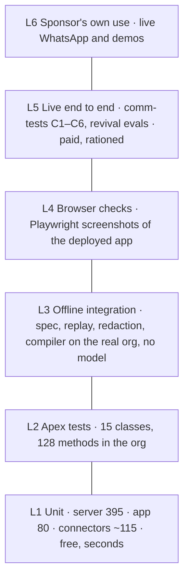

# Archon — Test Strategy

| | |
|---|---|
| Document | 04 · Test strategy |
| Product | Archon, by Aeventra AI |
| Version | 0.1, draft for review |
| Date | 24 October 2026 |
| Owner | Annu (sponsor and product owner) |
| Audience | Engineers writing and running tests, the sponsor who pays for live runs, and the release gatekeeper |
| Traces to | [02 · Product requirements](02-product-requirements-next-release.md) (every requirement gets a test id here); [01 · Architecture](01-solution-architecture.md) sections 5, 9 and 13 |
| Sources | Test files and scripts in the repositories on 24 October 2026; the suites were run that day: server 395 of 395, React app 80 of 80 |

## 1. Principles

1. **The cheapest test that can catch the bug is the one we write.** Most of Archon's logic (budgets, identity, approvals, expressions, spec validation, protocol framing) is pure and is tested without a model, an org or a network.
2. **Live model runs are rationed.** They spend the sponsor's money. One verification run per change, with a budget brake, agreed before it is spent. A failed paid run is a finding, never silently retried.
3. **Verify where the user is.** A screen change is checked in the real org in a real browser with a screenshot; an agent change is checked on a real transcript. Replay the real session's turns and tool calls before explaining agent behaviour.
4. **Measure, fix, re-measure.** Performance work carries an honest before-and-after table from `PhaseMsJson__c` or the build's `steps[].calls`.
5. **Every fix lands with a test at the lowest level that reproduces it.** The suite grew from zero to 395 server tests this way; the test names read as the bug list.

## 2. Test levels today

| Level | What | Where | Count on 24 Oct 2026 | Cost | Runs |
|---|---|---|---|---|---|
| L1 Unit, server | vitest over pure modules with fakes for Salesforce, Postgres and MCP | `server-langchain/test/*.test.ts` | 63 files, 395 tests, 16 s | free | `npm test` before every server release |
| L1 Unit, React app | vitest + jsdom over the data layer, protocol client and a card component | `uiBundles/AgentBuilderApp/src/**/*.test.*` | 12 files, 80 tests, 21 s | free | `npx vitest run` before every UI release |
| L1 Unit, connector servers | vitest | CRM 3 files (about 36 cases); Metadata 9 files (about 79 cases); Gmail and Outlook none | free | per connector release |
| L2 Apex | `@IsTest` classes in the org, with the server client mocked | `force-app/main/default/classes/*Test.cls` | 15 classes, 128 test methods | free, minutes | `sf apex run test` before every Salesforce release; coverage not yet recorded |
| L3 Offline integration scripts | Verifications that need real files or the real org but no model: architect spec and estimator, tool replay, trace redaction, prerequisites schema, compiler invariants on throwaway records | `server-langchain/scripts/*-verify.ts`, `architect-compile-test.ts` | 5 scripts | free | on change to the area |
| L4 Browser checks | Playwright against the deployed app: page, node form, runs, viewport, identity and approval screens; a walkthrough with mocked data on the dev server | `scripts/*-shot.cjs`, `*-check.cjs`, `walkthrough-archon.cjs` | 7 scripts | free, needs Chrome | after every UI change; the screenshot is the evidence |
| L5 Live end to end | Real builds and real conversations through the org's own Apex, scored without an AI judge: builder scorecard from the saved agent, conversation checks by regex and SOQL | `scripts/comm-tests/run.mjs` (6 cases C1–C6), `scripts/evals/run-evals.mjs` (revival agent), `scripts/ws-turn.mjs`, `measure-build.apex` | 6 cases, 66 conversation checks | paid: $4.62 for three rounds on 1 Oct; brake `COMM_TEST_BUDGET` 3.8 by default | on Architect or runtime changes, with the sponsor's go-ahead |
| L6 Sponsor's own use | Live WhatsApp, the demo agents, the Archon copilot | the dev org | | paid | continuous |



## 3. What is covered, by area

The test file names are the map. Each row names the area, the files that cover it, and what they prove.

| Area | Server tests | Proves |
|---|---|---|
| Turn budget and loop brake | `turn-budget`, `root-cap`, `reasoning-headroom` | caps, ceilings, the third identical call blocked, the fifth tripping, partial work reports |
| Streaming and protocol | `stream-call`, `stage-events`, `message-text`, `handoff-streaming`, `streamable-http-client` | delta and reset frames, stage frames, text extraction, subagent streaming, the MCP HTTP client |
| Prompt and context | `record-context-source`, `record-picklists`, `record-type-from-id`, `sender-phone-context`, `write-invalidates-record`, `kb-ready-cache` | the record block, picklist options, type inference, channel lines, cache invalidation on writes |
| Tools and honesty | `tool-honesty`, `allowed-tools`, `tool-node-connectors`, `connector-scope`, `connector-order`, `mcp-tool-cache`, `mcp-retry-partial`, `mcp-cold-start`, `platform-spill`, `platform-tool-cache` | errors marked as errors, allow-lists, scoping, caches, retries, cold-start budgets, spills |
| Approvals | `approval-audit`, `approval-outcome` | the System audit row and its replay as an outcome |
| Background tools | `background-tools` | queueing, the 8-second hold, still-running lines, timeouts as unconfirmed, orphan sweep |
| Handoff | `handoff` | the tool, assignee resolution, state written, lines read back |
| Headless and automation | `headless-runtime`, `ai-step-outputs`, `expressions`, `execution-result`, `automation-canvas`, `automation-shape` | AI steps, typed outputs, the expression language, result mapping, canvas compilation |
| Identity and security | `identity-resolver`, `action-identity`, `connectors-cache`, `installs-cache`, `salesforce-pkce-rotation`, `secret-box`, `namespace`, `platform-token` | resolver order, caches, PKCE and refresh rotation, sealing, namespace handling, platform JWTs |
| Architect | `architect-spec`, `architect-flow`, `design-robustness`, `field-check`, `name-repair`, `org-facts`, `spec-merge`, `specialist-findings`, `specialist-scratch`, `survey-inventory`, `manifest-from-inventory`, `structured-recovery`, `model-pricing`, `models`, `run-rules`, `round-two-fixes` | schema and logic validation, repairs, field checks, survey and manifest, structured-output recovery, pricing, model mapping |
| Platform and copilot | `mcp-endpoint`, `screen-tool`, `assist-tools`, `system-agents`, `agent-cache` | the MCP endpoint, `show_on_screen` rows, assist tools, system-agent sync, the agent cache |

| Area | React app tests | Proves |
|---|---|---|
| Protocol and data | `ws-chat`, `apex-client`, `wake-data`, `stream-pref`, `chat-list` | frame parsing, namespace fallback, wake classification, stream preference, list folding |
| Archon copilot | `archon-data`, `archon-intent`, `archon-screen`, `control-messages`, `build-report` | surfaces, the three remaining intents, screen parsing with rows, control chips, stage reports |
| Canvas | `flow-nodes` | ports per node |
| Cards | `ToolResultCards` | tool result rendering |

| Apex test class | Methods | Proves |
|---|---|---|
| `AgentChatControllerTest` | 29 | sessions, turns, history mapping, attachments, feedback |
| `AgentConnectorControllerTest` | 14 | directory, OAuth start, custom servers |
| `AgentBuilderControllerTest` | 12 | agent CRUD, execute, logs |
| `ArchonWakeServiceTest` | 11 | health probe classification, connector wake |
| `AgentKbControllerTest` | 10 | knowledge-base proxy |
| `AgentApprovalControllerTest` | 7 | decide and resume |
| `AgentHandoffServiceTest` | 7 | handoff lines, return, reply, customer message, overdue sweep, pickers |
| `ArchonSetupControllerTest` | 7 | setup start, status, reset |
| `AgentInvokeActionTest` | 6 | the invocable for chat and automation agents |
| `ArchonServerClientTest` | 6 | endpoint, auth header, errors |
| `AgentGuardrailsControllerTest` | 5 | the cap and the sum |
| `AgentRunnerTest` | 5 | run, key resolution, logs |
| `WhatsAppRevivalInitiatorTest` | 4 | revival trigger path |
| `WhatsAppAgentBridgeTest` | 3 | inbound bridge |
| `LeadAgentTriggerHandlerTest` | 2 | lead trigger path |

## 4. Where coverage is thin

Honest list, from the file names and the code reading:

1. **The automation walker's pause, resume and poller** have no unit test (no test touches `orchestrator/engine.ts`, `run-poller.ts` or `resumeRunById`); `expressions` and `ai-step-outputs` cover the pieces. Add walker tests with a fake connection before touching E3 or E7.
2. **The WebSocket gateway** (ticket redemption, origin check, rate limit, frame limits, failure persistence) has no direct test; `stream-call` and `stage-events` cover what it forwards.
3. **Apex coverage is not measured.** The package upload needs 75 percent; run `sf apex run test --code-coverage` and record the number.
4. **No continuous integration.** Neither the Salesforce nor the server repository has a workflow; the only automation is a husky pre-commit lint-staged hook and the graph rebuild. Tests run when a person runs them.
5. **No staging server.** Render builds Release, which is live. A Release push restarts the live server and kills running builds. A paid test run and a release cannot overlap.
6. **The LWC widget** has the jest tooling configured and no tests.
7. **Gmail and Outlook connector servers** have no tests.
8. **Security tests:** nothing exercises a user holding only the Archon Agent Invoker set, cross-org access to artifacts, or the Protected setting. Requirement E1 adds these.
9. **Load and soak:** nothing measures concurrent turns, the 20-message rate limit under load, or memory growth of the in-process caches.
10. **The React canvas** itself (drag, wire, save) is only checked by screenshots; there is no component test of the properties forms beyond `flow-nodes`.

## 5. Environments and data

| Environment | Used for | Constraints |
|---|---|---|
| Development org `AiAgentBuilderOrg` | Apex tests, browser checks, live runs, the sponsor's demos | shared by everything; test data is tagged `[ARCHON TEST]` and cleaned by the harness |
| Render Release | live server for every level above L3 | is production; no second instance |
| Vite dev server with mocked data | the Archon walkthrough and design checks | no chat (StrictMode double-mount blocks it on localhost) |
| A scratch org from `ArchonPackage/config/project-scratch-def.json` | package install tests, Professional Edition checks | not yet used; needs the package to regenerate (R10.1) |
| Planned: a staging Render service built from Pre-Release | paid runs and release rehearsal without touching live | sponsor decision; costs a second service |

Fixtures: the comm-tests `seed` step creates tagged Accounts, Contacts, Leads and Products and `cleanup` removes them and everything created since the run's start time; the revival evals reset one Opportunity and clear its intel, Tasks and Events between scenarios. The folder `client-test-fixtures/` is not test input: it holds customer-org metadata (approval processes, profiles, a profile-check manifest) used when checking a client org. The 360 SMS message template is never touched and no SMS leaves the org from a test (only the bridge sends).

## 6. Running the suites

```bash
export PATH="/c/Users/Annu/AppData/Local/nvm/v22.17.1:$PATH"
cd server-langchain && npm run lint && npm test                                   # L1 server
cd force-app/main/default/uiBundles/AgentBuilderApp && npx vitest run              # L1 app
sf apex run test -o AiAgentBuilderOrg --test-level RunLocalTests --code-coverage -w 30   # L2
cd server-langchain && npx tsx scripts/trace-verify.ts && npx tsx scripts/replay-verify.ts   # L3 examples
node scripts/page-shot.cjs /conversations                                           # L4
node scripts/comm-tests/run.mjs seed && node scripts/comm-tests/run.mjs build C3 && node scripts/comm-tests/run.mjs poll \
  && node scripts/comm-tests/run.mjs score && node scripts/comm-tests/run.mjs chat C3 && node scripts/comm-tests/run.mjs report   # L5, paid
```

Before an L5 run: wake the two Salesforce connector hosts and keep them warm; the server chats only with Active agents (the builder saves Draft, the runner activates); never run `poll` at the same time as `build` or `chat`; never push Release during a run.

## 7. Policies

- **Paid runs are agreed first.** Say what will run, the expected cost and the brake; run once; report the measured numbers and the spend.
- **One verification per change** for anything that costs money; batch fixes and verify at the end of a batch of similar stages.
- **Evidence over assertion.** A screenshot for a screen, a transcript for an agent, a before-and-after table for performance, a test run output for code. "Verified" without one of these is not verified.
- **Do not touch the sponsor's live agents** (the six in the org) without asking; test agents are created by the harness and deleted after review.
- **A failing test blocks the release**; a known failure is listed in the release note with an owner.

## 8. Test plan for the next release

Test ids map to the requirements in document 02. Levels refer to section 2.

| Id | Covers | Level | Test |
|---|---|---|---|
| T-E1.1 | R1.1 | L2 + L1 | Apex: async run inserts one row whose id the server reuses; server: route passes its correlation id to `runAgent`, status route returns the run |
| T-E1.2 | R1.2 | L2 | Metadata assertion: the custom metadata record has no `JwtSecret__c`; package build check passes |
| T-E1.3 | R1.3 | L2 + L4 | A test user with only Archon Agent Invoker cannot read `ArchonInstall__c`; the app still works for an admin (screenshot) |
| T-E1.4 | R1.4 | L1 | `secret-box` seals and opens `WsTicket.engineOverride` and `AgentRun.engineOverrideJson`; the backfill script covers both |
| T-E1.5 | R1.5 | L1 | artifacts route returns 404 for another org's session key |
| T-E1.6 | R1.6 | L2 + L4 | A chat-only test user starts a session, mints a ticket, lists conversations; cannot save an agent |
| T-E1.7 | R1.7 | L1 | retention starts without the admin key |
| T-E1.8 | R1.8 | L1 | each sweep deletes the right rows and leaves the rest |
| T-E1.9 | R1.9 | L1 + L3 | boot fails without `PLATFORM_TOKEN_SECRET` in production; the pollers' claim is atomic under two concurrent callers |
| T-E1.10 | R1.10 | L2 | every REST class queried as a restricted user returns only accessible fields |
| T-E1.11 | R1.11 | L1 (connector repos) | request-scoped bearer test as in the CRM server; logger prints no token characters |
| T-E1.12 | R1.12 | L2 + L1 | a run paused at an approval node produces one `AgentApproval__c` row; deciding it resumes the run; the overdue sweep marks it TimedOut |
| T-E2.1 | R2.1 | L1 + L5 | `field-check` with picklist cases; comm-tests C3–C6 show no invented values |
| T-E2.2 | R2.2 | L1 | relationship path cases, including a bad middle segment |
| T-E2.3 | R2.3 | L1 + L5 | a requirement naming a missing field yields a blocking prerequisite and a disabled node |
| T-E2.4 | R2.4 | L1 + L5 | questions the survey answers are not asked; a transcript shows only the rest |
| T-E2.5 | R2.5 | L5 | add a field, rebuild, the design uses it |
| T-E3.1 | R3.1 | L5 + L6 | the Account Pipeline Review build, graded by the sponsor, with the build's cost table |
| T-E3.2 | R3.2 | L1 | tool result starts with `REFUSED:`; a copilot transcript names it |
| T-E3.3 | R3.3 | L4 | Executions page shows input and output per step, including loop iterations (screenshot) |
| T-E3.4 | R3.4 | L1 | preview graph equals compiled nodes for a fixture spec |
| T-E4.1 | R4.1 | L5 | the 7-turn driver before and after, on the chosen model, with `PhaseMsJson__c` per turn |
| T-E4.2 | R4.2 | L2 | a failed background write produces one corrective message through the org's send path (mocked sender) |
| T-E5.1 | R5.1 | L4 + L2 | widget shows banner, reply and Return on a handed-off session; a reply becomes a Human row |
| T-E5.2 | R5.2 | L1 + L5 | compiler places a handoff node from a spec; C4–C6 designs contain one |
| T-E5.3 | R5.3 | L2 | closing the work item returns the session and writes the line |
| T-E5.4 | R5.4 | L6 | one live WhatsApp handoff, transcript on record |
| T-E6.1–T-E6.6 | R6.x | L1 + L5 | each connector: tool list test, one live call per tool, and a build whose requirement names it |
| T-E7.1–T-E7.5 | R7.x | L1 + L4 | walker tests per node (retry exhausted follows the error port, switch matches, merge waits); canvas screenshots |
| T-E8.1 | R8.1 | L1 + L4 | a stop frame between steps ends the turn with the partial reply persisted and tokens counted; a stop during a tool call waits for it |
| T-E9.1 | R9.1 | L3 + L6 | JWT mint against a scratch org with the packaged app; a user with no connection runs a Salesforce tool as themselves |
| T-E10.1 | R10.1 | L3 | `build-package-source.py` passes; `sf package version create` succeeds; scratch install runs all Apex tests |
| T-E10.2–T-E10.5 | R10.x | review | documentation and catalog checks on the release checklist |
| T-E11.1 | R11.1 | L3 | `/health` sampled every 10 minutes for a week, no response over 1 s |

## 9. Security review readiness checks

Before the first package upload, a pass over: no credential in git (`git log -p` grep for keys), every REST surface authenticated, sharing and FLS enforced (T-E1.10), `Protected` settings, EncryptedText on keys, CSP and remote sites minimal, trace redaction (`trace-verify.ts`), the two `without sharing` paths documented, and a user with each permission set walking the app.

## 10. Release gate

A release of either repository passes when: unit tests pass (L1), type checks pass, Apex tests pass in the org with the coverage number recorded (L2), the offline scripts for the touched area pass (L3), each changed screen has a fresh screenshot (L4), any paid verification agreed for the change has run once and its numbers are in the commit or the document (L5), the change is committed and merged on all four branches, and `/health` shows the new commit after the Release push.

## 11. Improvements to make this strategy real

1. **Continuous integration** on both repositories: vitest and `tsc` on every push; Apex tests on a scratch org nightly; package version create with validation weekly once R10.1 lands.
2. **A staging Render service from Pre-Release**, so paid runs and rehearsals never hit live.
3. **Walker and gateway unit tests** (section 4, items 1 and 2) before E3, E7 and E8.
4. **Apex coverage recorded** in the release note.
5. **A security test user per permission set** kept in the dev org.
6. **A tiny load test** (ten concurrent socket turns on a no-tool agent) run before the AWS move and after.
